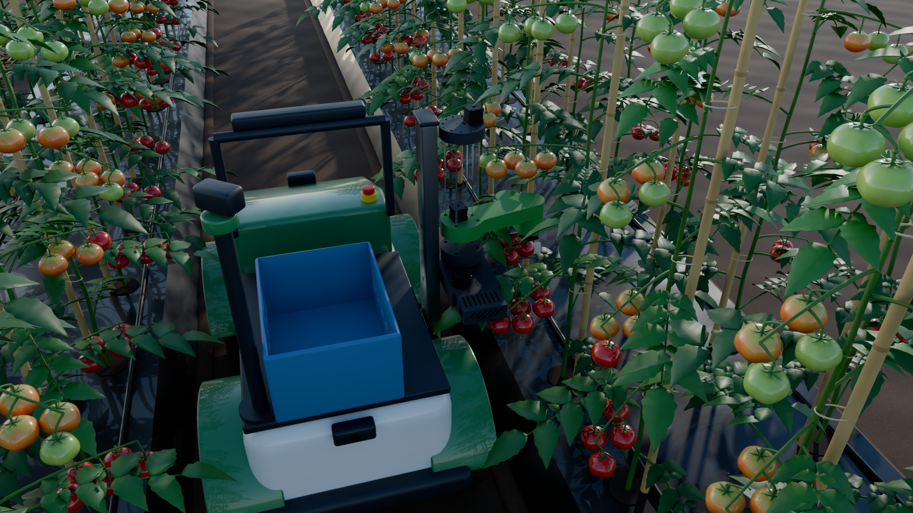
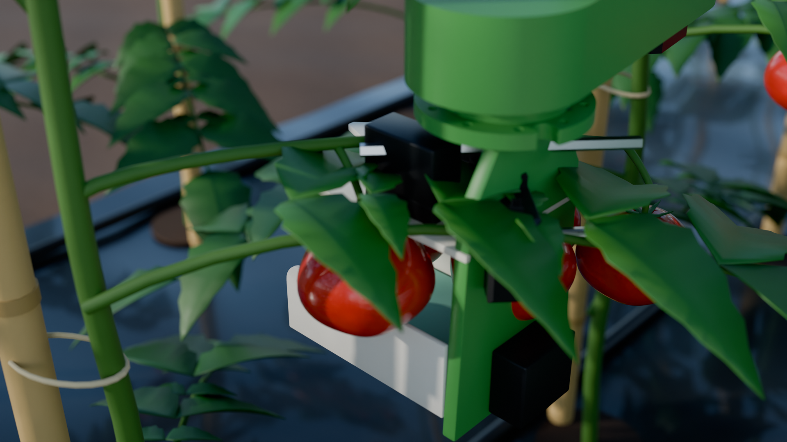
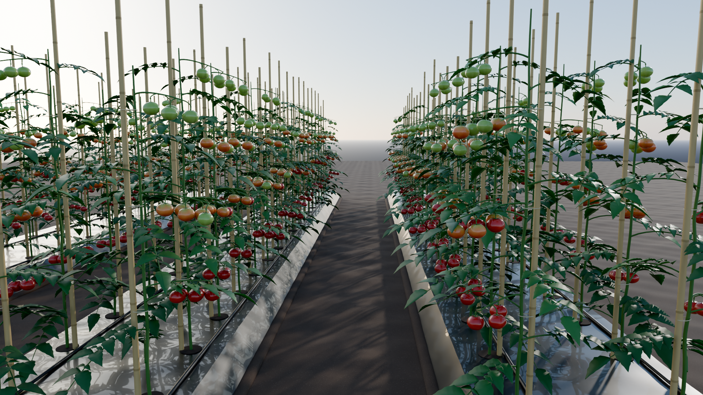

# AgriBOT

An autonomous tomato-harvesting rover. It drives tomato rows, finds ripe fruit with its cameras, and harvests it with a SCARA arm on a converted ride-on chassis. The target is a functional field prototype on a budget of about ₹10 lakh.



| | |
| --- | --- |
|  |  |

## What's here

| Area | Status | Start with |
| --- | --- | --- |
| Project plan, purpose, open questions | Current | [docs/project-context.md](docs/project-context.md) |
| Simulation assets: rover, SCARA, cutter, tomato field | v0.1, built on Windows | [docs/assets.md](docs/assets.md) |
| Robot description (URDF/xacro, ROS 2 package) | Generated and checked on Windows; not yet run in ROS | [sim/agribot_description](sim/agribot_description) |
| Field models for Gazebo and Unreal | Generated; not yet loaded in Gazebo | [sim/agribot_field](sim/agribot_field) |
| SCARA redesign and tomato cutter | Concept, waiting on bench tests | [docs/scara-redesign.md](docs/scara-redesign.md) |
| Simulation pathway | Plan | [docs/work-plan.md](docs/work-plan.md), [docs/ros2-demo-sim-plan.md](docs/ros2-demo-sim-plan.md) |
| Stock rover control board (reverse engineering) | In progress | [docs/rover-control-board.md](docs/rover-control-board.md), [docs/rover-logic-interface.md](docs/rover-logic-interface.md) |
| Bills of materials and orders | Current | [docs/bill-of-materials.md](docs/bill-of-materials.md), [docs/bill-of-materials-priced.md](docs/bill-of-materials-priced.md) |

`notes.md` tracks the open tasks (AB-1 to AB-8). `preferences.md` records the working rules agreed so far.

## Repository layout

```
docs/                     plans, designs, bills of materials, renders (docs/images)
sim/
  agribot_description/    ROS 2 package: URDF/xacro, meshes, frames, display launch
  agribot_field/          ROS 2 package: Gazebo models (tomatoes, plants, beds, soil) + glTF
tools/
  scara/                  STEP -> URDF links (OpenCascade)
  blender/                procedural assets and renders (Blender 5.1)
  description/            URDF generator and a small FK/IK helper
media/                    board photos and models; third-party SCARA CAD (local only)
internal/                 working notes and photo cross-checks
```

## The robot in one paragraph

**Chassis:** a Chinese ride-on car body, 1.20 × 0.70 × 0.80 m on 0.38 m tyres. Its stock board drives four wheel motors and a steering motor, and that board is being reverse-engineered for autonomy.

**Arm:** a SCARA arm (L1 228 mm, L2 136.5 mm, 249 mm Z stroke) pins onto a side mast at one of five heights. It carries a V-capture bypass cutter that:
- slides a 6 mm throat onto the thin stem just above the fruit (the distal pedicel)
- slices it at the cheapest point (about 20–34 N)
- catches the fruit in a padded cradle
- drops it into the crate on the rover's deck

**Cameras:** front and rear RGB, an RGB-D camera on the cutter, and a scouting camera on a pan mast. They feed row navigation and a ripe-fruit detector.

## Getting started

Rebuild every asset on Windows (needs Blender 5.1 and Python 3.11). Full commands are in [docs/assets.md](docs/assets.md#rebuilding).

```bash
python -m venv .venv
.venv/Scripts/python -m pip install -r tools/requirements.txt
```

On Ubuntu 22.04 with ROS 2 Humble, the packages build like any colcon workspace. This hasn't been run yet: it waits on the Ubuntu install (AB-2).

```bash
mkdir -p ~/agribot_ws/src && ln -s "$(pwd)/sim" ~/agribot_ws/src/agribot
cd ~/agribot_ws && colcon build && source install/setup.bash
ros2 launch agribot_description display.launch.py tool:=cutter mast_pin:=2
```

## Third-party CAD

The SCARA is the HowToMechatronics design. Its CAD files (`media/scara-arm/`), and the meshes generated from them, are kept out of this repository because their redistribution licence is not known.

The scripts that turn that CAD into URDF links are included. With the CAD in place, they regenerate the meshes exactly, checked to 0.002 mm. See [docs/assets.md](docs/assets.md#third-party-sources).

## Licence

Apache-2.0 for everything authored here (see [LICENSE](LICENSE)). The third-party CAD above is not covered and is not distributed.
