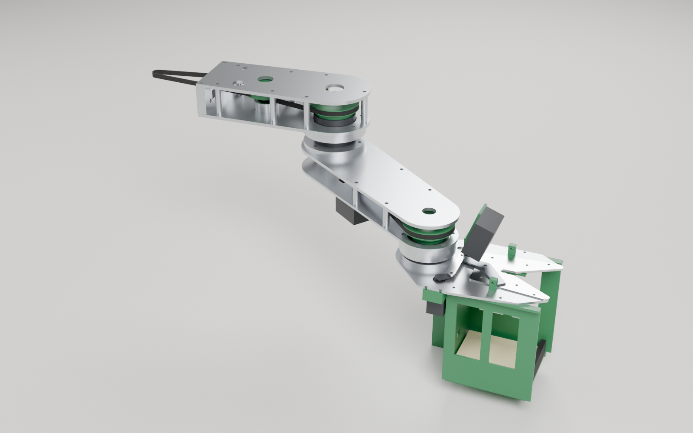
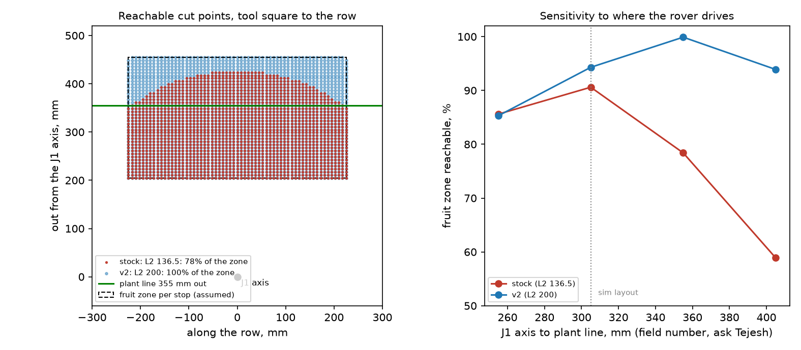
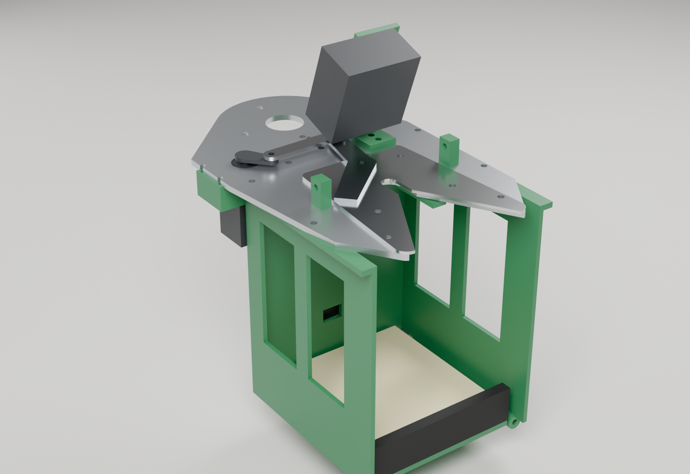
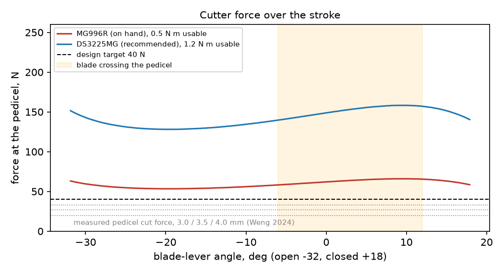

# SCARA arm v2 and the tomato cutter

Design of 4 Nov 2026. It replaces sections 2 and 3 of [scara-redesign.md](scara-redesign.md) (Arm 2 and the cutter concept). That document's literature figures, the height plan (section 4) and the questions for Tejesh (section 7) still apply.

**Status:** CAD complete and collision-checked. Nothing has been made or bench tested. The simulation still uses the 0.4.0 arm (L2 136.5 mm, cutter concept v0).

**Files:**
- CAD script: `tools/cad/build_arm_v2.py`
- Shared numbers: `tools/cad/arm_v2_geometry.py`
- Calculations: `tools/cad/arm_v2_calcs.py`, which writes `cad/arm-v2/calcs.json`
- Collision check: `tools/cad/check_arm_v2.py`
- Output, in [cad/arm-v2](../cad/arm-v2):
  - `agribot_arm_v2.step`: whole arm in the stock STEP frame, so it overlays the stock base
  - `end_effector.step`: the tool alone
  - `step/`: one file per made part
  - `dxf/`: laser and waterjet profiles of the plates
  - `stl/`: printed parts
  - `parts.csv`: part list with mass estimates

Every number below is tagged: **[M]** measured (stock STEP, a datasheet, or a cited paper), **[A]** assumed (a design choice or an unchecked value), **[E]** estimate (worked out; replace it with a measurement).

## 1. What stays and what changes

**Locked (already built, not touched):**
- The base and the J1 drive (20:1 through 20T→80T and 22T→110T).
- The Z column: 4 × Ø10 rods, 8 mm lead screw, 249 mm stroke [M].
- The Z carriage (the stock "Z-axis Mount Platform"), with the J2 motor and its 20T pulley.

**New:**
- **Arm 1.** It bolts to the carriage's existing face with the stock 4 × M5 pattern: ±25.5 mm apart, at z 245.1 and 263.1, 62 mm out from the J1 axis [M].
- **The J2 joint and Arm 2.** L2 = 200 mm [A].
- **The J3 joint**, with a standard tool flange.
- **The cutter.**

L1 stays at 228 mm [M]. The carriage fixes where the J2 motor sits. The two J2 belt stages (400 and 300 mm) only fit at the stock centre distances: 148.1 and 89.9 mm, which give 398.7 and 300.2 mm belt loops [M]. So the J2 drive keeps its stock geometry, including the stock 80T/23T compound pulley, which is reused.

## 2. Where every part on hand goes

Taken from the procured list and the OnlyScrews, Robocraze, Robokits, Robu and Amazon orders.

| On hand | Qty | Used for | Spare |
| --- | --- | --- | --- |
| NEMA17 7 kg·cm + DM542 | 1 | J1 (largest inertia) | 0 |
| NEMA17 7 kg·cm (premium) | 1 | J2, TB6600 | 0 |
| NEMA17 4.2 kg·cm (economy) | 2 | Z (TB6600); J3 (TB6600, under Arm 2) | 0 |
| TB6600 drivers / A4988 | 4 / 4 | TB6600 for Z, J2, J3 and one spare; A4988 for bench work | 1 / 4 |
| MG996R | 2 | Cutter blade, basket door | 0 |
| 51108 thrust, 40×60×13 | 3 | J1 (stock) ×2 | 1 |
| 51107 thrust, 35×52×12 | 3 | J2 ×2 | 1 |
| 6806-ZZ, 30×42×7 | 2 | J2 ×1, J3 ×1 | 0 |
| 6807-ZZ, 35×47×7 | 2 | J1 (stock) ×1, J3 ×1 | 0 |
| 608RS | 5 | J1 idler ×2, J2 idler ×2, Z screw ×1 | 0 |
| GT2 belts 200 / 300 / 400 | 1 / 2 / 2 | J1: 200 + 300. J2: 400 + 300. J3: 400 | 0 |
| GT2 20T pulley, 5 mm bore | 6 | J1, J2, J3 motors | 3 |
| GT2 toothless idler, 5 mm bore | 6 | Belt tensioners in Arm 1 ×2 (the stock arm had none) | 4 |
| Roller micro switches | 10 | Z top, J1, J2 and J3 home, cutter feeler | 5 |
| M4 × 40 / M4 × 50 | 25 / 10 | Arm 2 spacer bolts ×5 / Arm 1 spacer bolts ×7 | |
| M5 × 25 | 15 | Arm 1 to carriage ×4 | |
| M8 × 45 | 2 | Axle for the J2 compound pulley (an M8 × 50 gives a full nut, if you can get one) | |
| Compression springs OD 4 / OD 6 | 4 / 4 | Feeler fork bias / blade pivot preload | |
| 12 A buck, XL4015, ESP32-S3 | 1 each | Servo rail at 6.0 V; 5 V logic; arm controller | |

The stock design needed four 51107 and a pancake motor for J3. You have three 51107 and no pancake motor. v2 builds J3 from the spare 6806 and 6807, and moves a standard NEMA17 to Arm 2. You only buy what the cutter needs (section 7).

## 3. Reach: why L2 = 200 mm

The tool approaches square to the row, so the wrist sits a fixed distance behind the cut point: 88 mm for v2, 64 mm for the stock gripper. J2 is limited to ±150°. That limit, not the link lengths, sets the inner edge of the workspace.

The fruit zone for one rover stop is 450 mm along the row. Across the row it runs from 150 mm on the near side of the plant line to 100 mm beyond it [A].

| J1 axis to plant line | Stock (L2 136.5) | v2 (L2 200) |
| --- | --- | --- |
| 255 mm | 86% | 85% |
| 305 mm (sim layout [A]) | 91% | 94% |
| 355 mm | 78% | **100%** |
| 405 mm | 59% | **94%** |

The stock arm only works if the rover drives close to the plants. v2 keeps 94–100% of the zone even if the rover drives 100 mm further out. Lengths of 180–228 mm all score within 1% at 305 mm. 200 mm is the shortest length that holds up at 405 mm.

The one field number that decides this is **how far the plant line is from the rover's side**. Ask Tejesh for it (question 1 in [scara-redesign.md](scara-redesign.md) section 7).

## 4. The links

### Construction

Both links are **aluminium sandwiches**: two 6061-T6 plates, laser or waterjet cut, held apart by tube spacers on long M4 bolts, with the belt inside.

**Why aluminium, not printed:**
- PLA softens at 55–60 °C, and dark parts get that hot in field sun.
- The plates are far stiffer than a printed box. With spacers only, the Arm 2 tip moves 0.003–0.5 mm under the tool plus a 250 g fruit [E]. The low figure is a closed box; the high one is two plates acting alone.
- Add 1 mm aluminium side skins and it becomes a closed box. That also keeps leaves out of the belts.

Each plate is a 2D profile, so a college laser, waterjet or CNC router can cut it from the DXF.

| | Arm 1 | Arm 2 |
| --- | --- | --- |
| Length between joints | 228.0 [M] | 200.0 [A] |
| Plates | 4 + 4 mm, 36 mm gap | 4 mm top, 3 mm bottom, 25 mm gap |
| Inside | J2 stage 1 and stage 2 belts, stock 80T/23T pulley on 2 × 608 in a turned cup, two tensioner idlers on slots | J3 belt: 20T on the J3 motor → 90T on J3 |
| Fixing | U-block root flange on the carriage face (4 × M5), plates screwed into it (M4 tapped) | J2 spindle flange under the top plate (6 × M4 through, nuts inside) |
| Mass, made + bought parts | 1.03 kg [E] | 0.92 kg [E] |

### J2 joint

The stack is the stock arrangement (two 51107 plus one 6806), rebuilt in aluminium. From the bottom up:

| z (STEP frame) | Part |
| --- | --- |
| 196–204 | J2 spindle flange (Ø78), bolted to the Arm 2 top plate |
| 204–216 | 51107, lower |
| 216–228 | J2 hub (Ø78), bolted under the Arm 1 bottom plate; 6806 inside at 216–223 |
| 228–240 | 51107, upper, sitting in a Ø54 hole in the Arm 1 bottom plate |
| 240–254.4 | 92T pulley (printed). Its Ø35 spigot centres the upper thrust. 4 × M4 screws into the spindle top clamp the stack. |

The spindle is hollow (Ø16), so the cables from Arm 2 and the tool run up through the joint.

### J3 joint and the tool flange

- **Bearings:** the 6806 (lower) and 6807 (upper) sit back to back on a stepped spindle. A web in the J3 hub carries both outer rings.
- **Preload:** the 90T pulley pulls the spindle up. Add a 0.1–0.2 mm shim if there is play.
- **Tool flange:** Ø60, 4 × M4 tapped on a 48 mm PCD, a Ø20 spigot and a Ø4 dowel at 45°. Any future tool bolts on here.
- **Cables:** Ø14 bore through the spindle.

### J3 motor placement (no new belt)

A 400 mm belt on 20T→90T needs a 143.3 mm centre distance [M]. So the J3 motor hangs under Arm 2, 143.3 mm from J3 (56.7 mm from J2). Its plate slots give ±4 mm of belt tension. Because it sits close to J2, it adds almost nothing to J2's inertia, so L2 can grow without buying a belt.

The ratio stays 4.5:1. That gives the economy NEMA17 about 1.8 N·m at J3 [E], far more than the tool needs.

### Joint limits (from the CAD collision check)

- **J2: ±150°.** No contact between Arm 1, Arm 2 and the tool anywhere in this range.
- **J3: −110° to +95°.** Past this, the camera on the tool meets the underside of Arm 2. Put hard stops 5° beyond the soft limits. The cutter only needs to face away from Arm 2, and this range covers that.

### Loads and resolution [E]

| | Value | Margin |
| --- | --- | --- |
| Bending moment at J2 (Arm 2 + tool + 250 g fruit) | 2.7 N·m | 51107 pair: very large |
| J1 inertia (whole arm, fruit, full reach) | 0.30 kg·m² | |
| J1 torque for 3 rad/s² | 0.9 N·m | 5.9 N·m available (0.69 N·m × 20 × 0.85, then halved) |
| Z load (arm + tool + fruit + carriage share) | 32 N | 0.14 N·m on an 8 mm-lead screw against 0.41 N·m: ×3 |
| Tip movement per 1/16 microstep | J1: 0.04 mm at full reach. J2: 0.02 mm | |

**The Z axis is back-drivable with an 8 mm lead [A].** If the Z motor loses power, the arm drops. Keep the motor enabled, and before a power-down drive Z to its lowest position, or add a brake. Check the lead on the screw you bought: 2 mm or 8 mm.

## 5. The end effector

### Decisions

| Question | Options weighed | Choice and reason |
| --- | --- | --- |
| How to separate the fruit | Pull or twist at the knuckle; rotating disc; scissor pair; hot wire; bypass shear | **Bypass shear against a fixed edge.** Pulling needs clamping near the 11 N bruise limit, and only reached 72.9% success in bending mode [M]. A disc cuts anything it touches: leaves, the truss, the next fruit. A scissor pair with converging blades shears every stem inside its mouth. A hot wire is slow and power-hungry. With a bypass shear, only the stem that is in the 8 mm slot can be cut. |
| Blade | Utility-knife insert; bought pruner blade; our own blade-lever | **Our own blade-lever**: 2 mm EN42 spring steel or SS420, laser cut, hardened, with a 25° single bevel. Thin snap-off blades flex away from the shear edge. A bought pruner blade wouldn't match the CAD. |
| Actuator | Servo; stepper and screw; DC gearmotor and screw; solenoid | **Standard-size servo through a 4-bar.** It holds position, drives straight from the ESP32 with PWM, and needs no limit switch. The servo case and 25T spline are standard, so **DS3225MG (25 kg·cm, recommended) and MG996R (on hand) are interchangeable**. |
| Approach | From below; from the side | **From the side, at calyx height.** The links stay out of the canopy. The V mouth catches a pedicel up to ±25 mm off the aim. In the sim the vision estimates were 6–24 mm off. |
| Getting the cut height right | Trust vision; detect the pedicel; touch the fruit | **Touch the fruit.** After the pedicel is in the slot, Z lowers the deck slowly until a feeler fork under the deck meets the fruit's shoulders. The cut is then a fixed ~7 mm above the shoulders, whatever the camera thought. This fixes the 6–24 mm pedicel error from the sim mechanically. |
| Holding the cut fruit | Fingers; suction; basket | **Basket with a padded door.** The fruit falls about 3–8 cm onto 10 mm foam (section 5.4). A 10 mm TPU lip keeps it in while the arm backs out. Nothing squeezes the fruit. |
| Into the crate | Trap door over a funnel; carry it to the crate; fabric sleeve | **Trap door over a padded funnel** on the rover, with a fabric decelerator sock down into the crate (section 5.5). A sleeve hanging from the tool snags in the canopy. |
| Any other motion? | Wrist pitch; a second cutter axis | **None.** Tomatoes hang under their pedicels. The arm gives x, y, z and yaw (J3), which is all the approach needs. A pitch axis would add a motor, mass and cables for fruit the V already handles. |

### 5.1 How one pick goes

1. **Plan.** The camera (D405 class, 7 cm minimum range [M datasheet]) finds the fruit 15–35 cm away. The planner picks a J3 yaw so that the open mouth faces a side with no neighbouring fruit.
2. **Pre-pose.** The throat is aimed 60 mm short of the pedicel along the approach line. The deck is aimed at the estimated calyx height + 15 mm, so a ±15 mm height error never runs the deck into the fruit [A].
3. **Advance** at 30 mm/s until the IR beam across the throat breaks: the pedicel is in the slot. If 80 mm of travel goes by with no break, back out and re-detect.
4. **Touch-off.** Lower Z at 5 mm/s until the feeler releases its switch (at most 40 mm).
5. **Cut.** Swing the blade quickly to −8°. Then cross the pedicel slowly (−6° to +12° in about 1.5 s, roughly 4 mm/s at the stem), as Weng et al. 2024 recommend [M]. The raked edge pulls the pedicel into the end of the slot rather than pushing it out.
6. **Check.** The TCRT5000 in the rear wall should see the fruit within 0.5 s.
7. **Retreat.** Open the blade and back out along the approach line, accelerating at ≤ 0.5 m/s².
8. **Unload.** Move over the funnel, open the door to 75° for 0.6 s, close it, and check that the basket reads empty.

Cycle time is about 8–10 s per fruit [E], mostly arm travel to the funnel.

### 5.2 Cutter mechanics

| | Value | Tag |
| --- | --- | --- |
| Slot width, length | 8 mm, 12 mm, then a 60° V to a 50 mm mouth | A |
| Distal pedicel diameter, cut force | 3–5 mm; 19.6 N at 3 mm, 26.7 N at 3.5 mm, 33.0 N at 4 mm | M (Weng 2024) |
| Design force | ≥ 40 N at the stem | A |
| Blade-lever pivot to stem | 20 mm | A |
| 4-bar (horn, link, lever arm) | 14 mm, 40 mm, 30 mm; servo travel 118° for 50° of blade | A, from the search in `arm_v2_calcs.py` |
| Lowest force ratio while cutting | 2.33 | E |
| Force at the stem while cutting, MG996R (0.5 N·m usable) | ≥ 58 N | E |
| Same, DS3225MG (1.2 N·m usable) | ≥ 140 N | E |
| Edge rake | 15° toward the slot end | A |

The MG996R clears the 40 N target, but only by about 1.5× when it is near half of its stall torque. Clone MG996Rs vary. Start with the one you have, and fit the DS3225MG if bench test 1 shows stalls. Run both servos from the 12 A buck at 6.0 V, never from the logic rail: an MG996R can draw more than 2 A when stalled.

The V-plate (1.5 mm SS410 or SS304) carries the shear edges. Keep its slot edges square and sharp; don't chamfer them. The blade slides on the plate's top face. A spring under the pivot bolt head (the OD 6 spring) keeps the blade pressed flat against it.

### 5.3 Sensors

| Signal | Part | Note |
| --- | --- | --- |
| Pedicel in the throat | 38 kHz modulated IR LED + TSOP38238 receiver in the two posts beside the throat | Use modulated IR. A plain phototransistor is blinded by sunlight. The posts sit outside the blade's sweep. |
| Deck has touched the fruit | Feeler fork (printed) on an M3 pivot; its tail holds a roller micro switch closed | At rest the switch is pressed; contact releases it. A broken wire then reads as "touched", which stops the descent: fail-safe. Bias it with the OD 4 spring. |
| Fruit in the basket | TCRT5000 behind a window in the rear wall | It also confirms the basket is empty after a drop. |
| Blade open | Servo position command | Optional: a magnet on the lever and a hall switch, if a stalled servo needs catching. |

### 5.4 Basket, fruit size and drop height

- **Inside:** 95 × 95 mm. The front is open. The door pad sits 118 mm below the deck top [A].
- **Fruit up to 85 mm wide and 75 mm tall clears the 10 mm lip on the way in [A]**, even with the deck 30 mm above the calyx (the worst case of the ±15 mm aim).
- **Drop after the cut:** 112 mm minus the fruit's height (the pad is 118 mm below the deck top; the fork touches the fruit 6 mm below it).
  - Typical 60–80 mm Indian table fruit (50–65 mm tall [E]): about 45–60 mm.
  - A 40 mm fruit: about 80 mm.

On 10 mm EVA or PU foam that is below the bruising energy for typical fruit [E]. Bench test 3 checks it.

The side walls have windows to save weight. The lower 35 mm is kept solid so the fruit can't roll out.

### 5.5 Unloading

- **Drop pose:** the door opens downward on a hinge along one side, so the fruit rolls off one edge into a padded funnel (mouth about 200 mm).
- **Funnel position:** fix it to the SCARA base, so it moves with the mast pins and the drop pose is the same joint set at every pin height. It sits inboard of J1 (over the rover deck), 250 mm from J1, which is outside the 114 mm inner limit set by J2.
- **Into the crate:** a fabric sock (a decelerator tube, as on apple platforms) runs from the funnel into the crate.
- **Low pins:** at pins 0 and 1 the SCARA base sits at or below the 0.50 m deck. The crate then has to ride lower, on a side tray, for the sock to drain. This is a rover-layout decision. It is listed as open item 3.

### 5.6 Parts and mass

| Id | Part | Material and process |
| --- | --- | --- |
| T-01 | Deck | 6061-T6 3 mm, laser/waterjet |
| T-02 | V-plate with the shear edges | SS410 (or SS304) 1.5 mm, laser |
| T-03 | Blade-lever | EN42 or SS420 2 mm; laser, harden to about 52–56 HRC, grind a 25° bevel |
| T-04 | Link | SS304 2 mm or 6061 3 mm |
| T-05 | Cutter servo bracket | PETG |
| T-06 | Basket | PETG, 3–4 walls |
| T-07 / T-08 / T-09 | Door, foam pad, lip | PETG / 10 mm EVA / TPU 95A |
| T-10 | Door servo bracket | PETG |
| T-11 / T-12 | Feeler fork, hinge blocks | PETG |
| T-13 | IR posts | PETG |
| T-14 | Camera bracket | PETG |

**Tool mass, including two servos and the camera: about 530 g [E].** That is heavier than the 325 g in the earlier budget, because of the metal deck, the V-plate and the touch sensor. The arm loads above include it.

## 6. Making it

| Process | Parts | Notes |
| --- | --- | --- |
| Laser or waterjet, 6061-T6 | A1-01, A1-02 (4 mm); A2-01 (4 mm); A2-02, T-01 (3 mm) | DXFs in `cad/arm-v2/dxf`. Drill or ream bearing and pin holes after cutting. |
| Laser, stainless or spring steel | T-02, T-03, T-04 | Harden T-03 before grinding. Hone the edge. |
| Turning, 6061 bar | J2 spindle and hub (Ø80 bar); J3 spindle and hub (Ø65); idler cup (Ø45) | Bearing seats H7: Ø42, Ø47, Ø22. Shaft seats j6: Ø30, Ø35. Thrust seats Ø35 h7. Tap M4 where the STEP shows Ø3.3 holes. |
| Milling | A1-03 root flange | Check the M5 holes against your printed carriage before drilling. |
| Printing | Pulleys J2-02 (92T) and J3-02 (90T); all T-0x PETG parts; TPU lip | **Print a 10 mm test ring of each pulley first and check the belt seats.** The GT2 teeth are an approximation. |
| Bought | DS3225MG (optional), TSOP38238 + IR LED, TCRT5000, 10 mm EVA, M4 shoulder bolt, M3 heat-set inserts, 1 mm aluminium for side skins, aluminium tube 8 × 1.8 | |

Assembly order:
1. Root flange to the carriage.
2. Belt 1 through the U, round the motor pulley.
3. Arm 1 bottom plate, the cup and compound pulley, the J2 hub.
4. The J2 stack: lower thrust, spindle, 6806, upper thrust, pulley.
5. Arm 1 top plate. Tension both idlers.
6. Arm 2 plates, the J3 hub and spindle, the J3 motor and belt (tension with the motor slots).
7. The tool on the flange.

## 7. Bench tests before the field

1. **Cut force on your variety** (as in scara-redesign.md test 1). Then cut 20 pedicels in the real cutter with the MG996R. Pass: 20 of 20 cut, no stall.
2. **Touch-off.** Lower the deck onto 10 fruit on a staked plant at 5 mm/s. Measure the stub left after the cut. Target: under 10 mm (FAO about 1 cm [M]).
3. **Drop.** Drop 10 ripe fruit from the measured drop height onto the pad. Check for bruising after 24 h.
4. **Capture tolerance.** Approach a pedicel 0, 10, 20 and 25 mm off the aim. Pass: it enters the slot every time.
5. **IR in sunlight.** The beam must break on a 3 mm pedicel in direct sun.

## 8. Open items

1. **The field number:** the distance from the rover's side to the plant line (section 3).
2. **Z lead screw:** 2 mm or 8 mm lead? An 8 mm lead needs a brake or a park routine.
3. **Crate position for low mast pins** (section 5.5).
4. **Economy motor length:** 40 mm is assumed. Measure it and update `NEMA17` in `arm_v2_geometry.py` before cutting the Arm 2 bottom plate.
5. **Stock compound pulley:** check its bore and height on the printed part. The cup assumes Ø8 and 246.2–265.0 mm in the STEP frame.
6. **Simulation:** update the URDF to L2 = 200 mm and the v2 cutter geometry, then re-run the Gazebo harvest. Do this after the field number is known.

**Not checked:** no FEA has been run. The masses use typical datasheet weights for bought parts. Fits are nominal. The GT2 tooth form needs the test print.
