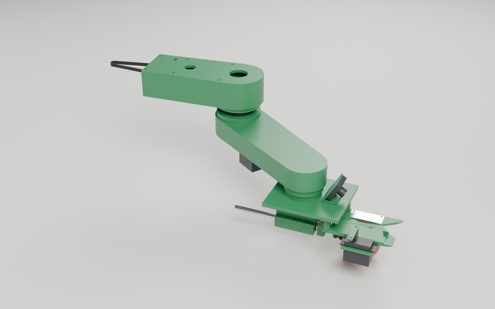
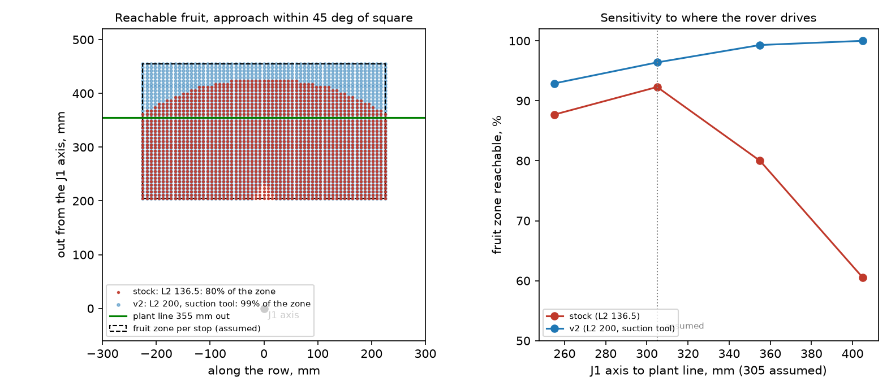
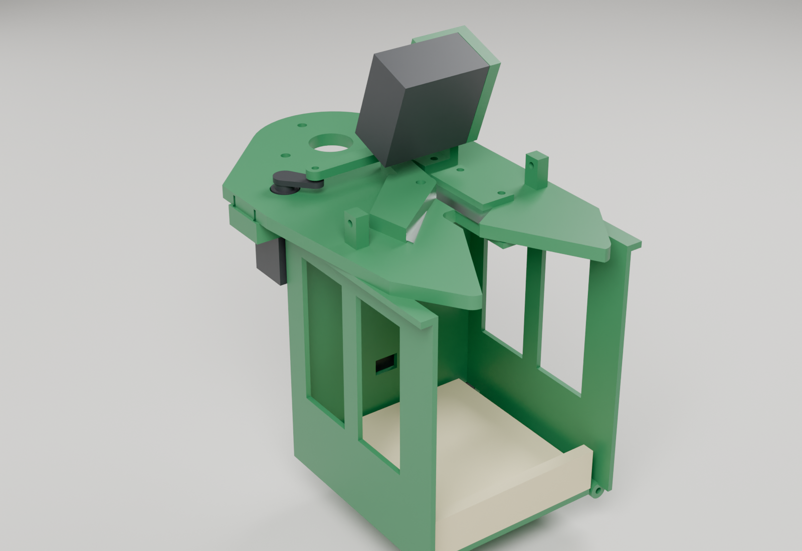
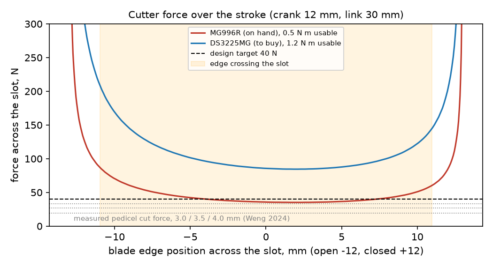

# SCARA arm v2 and the tomato cutter

First design 4 Nov 2026. **Reworked 8 Nov 2026:**
- Every made part is now printed in PETG on the Anycubic Kobra S1 (250 × 250 × 250 mm bed). There are no aluminium or laser-cut parts.
- The end effector is now a suction draw-in tool with a guillotine cutter (section 5), chosen for autonomous picking in clusters on a low budget.

This document replaces sections 2 and 3 of [scara-redesign.md](scara-redesign.md) (Arm 2 and the cutter concept). That document's literature figures and its height plan (section 4) still apply.

**Status:**
- Already built (printed in PLA): the base, the 4 rods and the lead screw, the Z carriage, and the top cap with its stepper and limit switch.
- Arm 1, Arm 2, J2, J3 and the end effector: CAD complete. It is collision-checked (including the Z column) and checked against the print bed. Nothing is printed or bench tested yet.
- The simulation still uses the 0.4.0 arm (L2 136.5 mm, cutter concept v0).

**Files:**
- CAD script: `tools/cad/build_arm_v2.py`
- Shared numbers: `tools/cad/arm_v2_geometry.py`
- Calculations: `tools/cad/arm_v2_calcs.py`, which writes `cad/arm-v2/calcs.json`
- Collision and bed check: `tools/cad/check_arm_v2.py`
- Output, in [cad/arm-v2](../cad/arm-v2):
  - `stl/`: every printed part, ready to slice
  - `step/`: the same parts as STEP
  - `agribot_arm_v2.step`: the whole arm in the stock STEP frame, so it overlays the stock base
  - `end_effector.step`: the tool alone
  - `parts.csv`: part list with print settings and mass estimates

Every number below is tagged: **[M]** measured (stock STEP, a datasheet, or a cited paper), **[A]** assumed (a design choice or an unchecked value), **[E]** estimate (worked out; replace it with a measurement).

## 1. What stays and what changes

**Already built, not touched:**
- The base and the J1 drive (20:1 through 20T→80T and 22T→110T).
- The Z column: 4 × Ø10 rods, 8 mm lead screw, 249 mm stroke [M].
- The Z carriage (the stock "Z-axis Mount Platform"), with the J2 motor and its 20T pulley.
- The top cap with the Z motor and the top limit switch.

**New, all printed:**
- **Arm 1.** A tray and a lid. It bolts to the carriage's existing face with the stock 4 × M5 pattern: ±25.5 mm apart, at z 245.1 and 263.1, 62 mm out from the J1 axis [M].
- **The J2 joint and Arm 2.** L2 = 200 mm [A]. Arm 2 is a body and a cover.
- **The J3 joint**, with a standard tool flange.
- **The end effector** (suction draw-in, hood, guillotine cut).

L1 stays at 228 mm [M]. The carriage fixes where the J2 motor sits. The two J2 belt stages (400 and 300 mm belts) only fit at the stock centre distances: 148.1 and 89.9 mm, which give 398.7 and 300.2 mm loops [M]. So the J2 drive keeps its stock geometry, including the stock 80T/23T compound pulley. Print that one from the stock STL.

### Material: PETG for every new part

| | PLA | PETG | ABS |
| --- | --- | --- | --- |
| Softens at (glass transition, filament datasheets) | 55–60 °C | about 80 °C | about 100 °C |
| Warping, shrinkage | Low | Low | High; bearing seats and pulley teeth come out undersize |
| Layer bonding | Good | Very good | Good in an enclosure |
| Verdict | Already used for the base; keep it there | **Use for the arm and the cutter** | Fallback for any part that softens in the sun |

Dark parts in field sun can pass 55 °C, so new load-bearing parts should not be PLA. PETG holds its size best, which matters for bearing seats and belt teeth. The Kobra S1 is enclosed, so ABS also works if a part ever needs more heat resistance. The PLA base and carriage are already built. Watch them in the sun, and reprint them in PETG if they creep.

**Filament:** the printed parts weigh about 0.9 kg [E]. Buy 2 kg of PETG so there is enough for test rings and reprints.

## 2. Where every part on hand goes

Taken from the procured list and the OnlyScrews, Robocraze, Robokits, Robu and Amazon orders.

| On hand | Qty | Used for | Spare |
| --- | --- | --- | --- |
| NEMA17 7 kg·cm + DM542 | 1 | J1 (largest inertia) | 0 |
| NEMA17 7 kg·cm (premium) | 1 | J2, TB6600 | 0 |
| NEMA17 4.2 kg·cm (economy) | 2 | Z (TB6600); J3 (TB6600, under Arm 2) | 0 |
| TB6600 drivers / A4988 | 4 / 4 | TB6600 for Z, J2, J3 and one spare; A4988 for bench work | 1 / 4 |
| MG996R | 2 | Cup slide on the tool | 1 |
| 51108 thrust, 40×60×13 | 3 | J1 (stock) ×2 | 1 |
| 51107 thrust, 35×52×12 | 3 | J2 ×2 | 1 |
| 6806-ZZ, 30×42×7 | 2 | J2 ×1, J3 ×1 | 0 |
| 6807-ZZ, 35×47×7 | 2 | J1 (stock) ×1, J3 ×1 | 0 |
| 608RS | 5 | J1 idler ×2, J2 compound-pulley axle ×2, Z screw ×1 | 0 |
| GT2 belts 200 / 300 / 400 | 1 / 2 / 2 | J1: 200 + 300. J2: 400 + 300. J3: 400 | 0 |
| GT2 20T pulley, 5 mm bore | 6 | J1, J2, J3 motors | 3 |
| GT2 toothless idler, 5 mm bore | 6 | Belt tensioners in Arm 1 ×2 (the stock arm had none) | 4 |
| Roller micro switches | 10 | Z top, J1, J2 and J3 home, slide home on the tool | 5 |
| M4 × 40 | 25 | Arm 1 lid into the tray columns ×6 | 19 |
| M4 × 30 | 25 | Arm 2 cover into the body columns ×5 | 20 |
| M4 × 20 | 15 | J2 hub ×6, J2 spindle flange ×6, J2 pulley ×3 (buy 5 more: section 7) | 0 |
| M4 nuts | 80 | Every M4 above that isn't in a heat-set insert | |
| M5 × 25 / M5 × 35 | 15 / 10 | Arm 1 to the carriage ×4 / idler axles ×2 | |
| M8 × 45 | 2 | Axle for the J2 compound pulley | 1 |
| M3 × 20 + nyloc | 100 / 30 | Link pins on the tool ×4 | |
| Compression springs OD 6 | 4 | Blade carrier preload (2) | 2 |
| 12 A buck, XL4015, ESP32-S3 | 1 each | Servo rail at 6.0 V; 5 V logic; arm controller | |

The stock design needed four 51107s and a pancake motor for J3. You have three 51107s and no pancake motor. v2 builds J3 from the spare 6806 and 6807, and hangs a standard NEMA17 under Arm 2.

## 3. Reach: why L2 = 200 mm, and where the plants are

**Assumed plant line: 305 mm from the J1 axis [A].** This is the project's field layout, also used in the Gazebo world ([assets.md](assets.md)):
- The rover is 0.70 m wide [M] and drives a 0.90 m furrow.
- The plant line is 0.30 m from the bed centre, with plants every 0.45 m.
- The SCARA base sits on the side mast, so J1 is 0.395 m from the rover centreline. The plant line is then about 0.30 m from J1.

Measure this on the first field visit and update `PLANT_LINE` in `arm_v2_calcs.py`.

The suction tool reaches 174 mm ahead of J3 to the fruit centre at first contact (64 mm for the stock gripper). The approach may be up to 45° off square to the row: the cup only needs a clear line to the fruit's visible face. J2 runs from −120° to +135° (section 4). The fruit zone for one rover stop is 450 mm along the row. Across the row it runs from 150 mm on the near side of the plant line to 100 mm beyond it [A].

| J1 axis to plant line | Stock (L2 136.5, gripper) | v2 (L2 200, suction tool) |
| --- | --- | --- |
| 255 mm | 88% | 93% |
| **305 mm (assumed)** | 92% | **96%** |
| 355 mm | 80% | 99% |
| 405 mm | 61% | 100% |

At the assumed 305 mm, any L2 from 160 to 228 mm scores 95–97%. 200 mm is kept because it covers 99–100% if the rover ends up driving further from the plants. The reach study does not check J3's limits; the motion planner must. The long tool also keeps Arm 2 in the aisle while only the cup enters the plant. Arm 2 is 278 mm overall, so it is printed diagonally on the bed (section 6).

## 4. The links

### Construction

Both links are **printed boxes**: a part with the walls and one face, plus a flat lid or cover, tied together by M4 bolts in printed columns. Each column has a side slot near its end for a trapped M4 nut. The belts run inside, which also keeps leaves out of them.

| | Arm 1 | Arm 2 |
| --- | --- | --- |
| Length between joints | 228.0 [M] | 200.0 [A] |
| Parts | A1-01 tray (8 mm floor, 3 mm walls, root wall, idler boss), A1-02 lid (5 mm), A1-03 J2 hub | A2-01 body (6 mm top, 3 mm walls), A2-02 cover (5 mm, with the J3 housing) |
| Overall height | 49 mm (z 224–273) | 36 mm (z 160–196) |
| Inside | J2 stage 1 and stage 2 belts, stock 80T/23T pulley on 2 × 608 in a boss in the floor, two tensioner idlers on slots | J3 belt: 20T on the J3 motor → 90T on J3 |
| Closing | 6 × M4 × 40 down through the lid into the columns | 5 × M4 × 30 up through the cover into the columns |
| Fixing | Root wall on the carriage face with 4 × M5 × 25, nuts inside | J2 spindle flange on the top with 6 × M4 × 20, nuts inside |
| Mass, printed + bought parts | 0.68 kg [E] | 0.70 kg [E] |

### Is printed stiff enough? [E]

Printed PETG (E about 1.8 GPa [A]) is about 40 times less stiff than aluminium. The box sections make up for it:

| | Value |
| --- | --- |
| Arm 1 section, bending / torsion | 478,000 / 658,000 mm⁴ |
| Arm 2 section, bending / torsion | 203,000 / 331,000 mm⁴ |
| Sag at the fruit, arm stretched straight (tool + 250 g fruit) | 0.29 mm |
| Same, with Arm 2 square to Arm 1 (Arm 1 twists 0.06°) | 0.55 mm |
| Moment at the carriage face | 5.8 N·m |
| Pull on each upper M5 bolt into the carriage | 58 N |

That is well inside what the vision can hit (the sim was 6–24 mm off). The sums treat the links as one solid box. The bolted lids, the bearing fits and the PLA carriage will add compliance, so measure the real sag after assembly. The carriage takes 58 N per upper bolt in printed PLA. Use washers on both sides, and check for creep after a hot day.

### J2 joint

The stack is the stock arrangement (two 51107s plus one 6806), now printed. The spindle goes in from below. Its diameters step down going up (78 → 35 → 30 mm), so it passes every bearing. From the bottom up:

| z (STEP frame) | Part |
| --- | --- |
| 196–204 | J2 spindle flange (Ø78), bolted to the Arm 2 top |
| 204–216 | 51107, lower |
| 216–224 | J2 hub (Ø78), bolted under the Arm 1 floor; 6806 inside at 216–223 |
| 228–240 | 51107, upper, in a Ø52.6 × 4 mm counterbore in the Arm 1 floor |
| 240–254.4 | 92T pulley (printed). Its Ø35 spigot centres the upper thrust. 4 × M4 × 20 go into heat-set inserts in the spindle top and clamp the stack. |

The spindle is hollow (Ø16), so the cables from Arm 2 and the tool run up through the joint and out through the Ø32 hole in the Arm 1 lid.

### J3 joint and the tool flange

- **Bearings:** the 6807 sits below and the 6806 above, in a boss under the Arm 2 cover. A 3 mm web between them only touches the outer rings. The bearings must go this way round: the spindle enters from below (flange, then Ø35, then Ø30), so the larger bore has to be at the bottom. The first v2 design had them the other way, which could not be assembled.
- **Load path:** the tool hangs on the 90T pulley. The pulley bears on the 6806 inner ring, and the 6806 sits on the web. Upward loads go from the spindle collar into the 6807 and then the web. Add a 0.1–0.2 mm shim if there is play.
- **Tool flange:** Ø60 × 8 mm, with 4 × M4 heat-set inserts on a 48 mm PCD at 45°, a Ø20 spigot, and a Ø4 dowel at 0°. Any future tool bolts on here.
- **Cables:** a Ø14 bore through the spindle and the pulley into Arm 2.

### J3 motor placement (no new belt)

A 400 mm belt on 20T→90T needs a 143.3 mm centre distance [M]. So the J3 motor hangs under the Arm 2 cover, 143.3 mm from J3 (56.7 mm from J2). Its slots give ±4 mm of belt tension. Because it sits close to J2, it adds little to J2's inertia.

The ratio stays 4.5:1. That gives the economy NEMA17 about 1.8 N·m at J3 [E], far more than the tool needs.

### Joint limits (from the CAD collision check)

- **J2: −120° to +135°.** Folded further, the tool meets the Z column rods (checked against the stock STEP for every J3 in range). The stock gripper could fold to ±150°; the longer suction tool cannot.
- **J3: −105° to +85°.** No contact with Arm 2 in this range; the camera on top of the tool is the part that limits it. Put hard stops 5° beyond the soft limits.
- The check also sweeps Arm 2 and the tool past the Z column (rods, lead screw, carriage, top cap) from the stock STEP.

### Arm 2 under Arm 1, not over

Whether Arm 2 sits over or under Arm 1 does not change how far the links push into the plant; that depends on the tool's reach ahead of J3. Under wins on everything else [E]:

| | Under (chosen, as stock) | Over |
| --- | --- | --- |
| J2 range | −120° to +135° (set by the tool and the Z column), and the tool can turn freely | About ±148–156°, and only if the tool always points away from Arm 1 |
| Tool | Hangs freely below the links | Needs a drop of at least 76 mm to clear Arm 1, so the cut point rises at least 66 mm and J3 carries more moment |
| J3 motor | Hangs under Arm 2, 143 mm behind J3, in the aisle | Could sit on top, but needs a new 280–320 mm belt and limits J2 to 131–141° |
| J2 drive | Stock belt geometry | Spindle reworked to rise through the Arm 1 lid |

The one argument for over is that Arm 2 would sit on its bearing rather than hang from it. Here the hanging load is about 15 N, against M4 heat-set inserts that hold hundreds of newtons.

### Loads and resolution [E]

| | Value | Margin |
| --- | --- | --- |
| Bending moment at J2 (Arm 2 + tool + 250 g fruit) | 2.8 N·m | 51107 pair: very large |
| J1 inertia (whole arm, fruit, full reach) | 0.29 kg·m² | |
| J1 torque for 3 rad/s² | 0.88 N·m | 5.9 N·m available (0.69 N·m × 20 × 0.85, then halved) |
| Z load (arm + tool + fruit + carriage share) | 26 N | 0.11 N·m on an 8 mm-lead screw against 0.41 N·m: ×3.7 |
| Tip movement per 1/16 microstep | J1: 0.04 mm at full reach. J2: 0.02 mm | |

**The Z axis is back-drivable with an 8 mm lead [A].** If the Z motor loses power, the arm drops. Keep the motor enabled, and before a power-down drive Z to its lowest position. Check the lead on your screw: 2 mm or 8 mm.

## 5. The end effector: suction draw-in, hood, guillotine cut

### 5.1 Why the first cutter was replaced

The first v2 tool approached sideways at stem height, caught the first stem that entered its slot, and dropped the fruit into a basket. For an autonomous robot it had four problems:

1. **It could cut the wrong fruit.** In a cluster, the stems of neighbouring fruit sit at the same height. The first stem into the slot may belong to a neighbour, which may be unripe.
2. **It depended on seeing the stem.** The camera finds the red fruit body within about ±5 mm, but the thin green stem is often hidden by leaves and other fruit.
3. **It was wide.** A 115 mm deck plus a 111 mm basket was pushed sideways into the foliage.
4. **The shear could not stay tight.** A 0.5 mm snap-off blade on printed parts flexes and drifts by 0.1–0.2 mm, so stems fold into the gap instead of being cut.

### 5.2 What the design has to respect [E unless marked]

| Fact | Number | Consequence |
| --- | --- | --- |
| Vision locates the fruit body well, the stem poorly | ±5 mm on the body; the stem is often hidden | Reference everything to the fruit, not the stem |
| The arm is weak sideways | 11 N at full reach from J1, 16 N from J2 (half rated torque) | The arm must not pull fruit off |
| Pulling down loads the carriage | A 30 N pull puts about 190 N on each upper M5 in the PLA carriage | The tool does the separating, with its own servo |
| Fruit hang in clusters | Neighbours touch | Only something slim may enter the cluster |
| Fruit size varies | 40–85 mm | The cut height must follow the fruit top, whatever the size |
| Distal pedicel cut force | 19.6–33.0 N for 3–4 mm [M, Weng 2024] | At least 40 N at the blade |

### 5.3 How it works

1. **Reach.** The 32 mm USB camera on the tool keeps the fruit centred while the arm advances. The cup is aimed about 26 mm below the fruit top. Only the 25 mm bellows cup, 72 mm ahead of the hood, enters the cluster. The arm advances until the vacuum sensor reads a seal, so depth from the camera does not need to be accurate.
2. **Draw in.** The slide servo pulls the cup back 72 mm, drawing the fruit out of the cluster. The fruit swings on its stem like a pendulum and rises until its top seats against the underside of the hood. Its stem points back toward the plant, so it threads itself into the hood's V mouth and slot. The slide-home switch confirms the fruit came all the way in. If the stem missed the slot, the fruit cannot pass under the hood: the switch is not reached or the seal breaks, and the robot retries with a small J3 turn.
3. **Cut.** The cutter servo pushes a standard utility blade across the slot. It shears the stem against the edge of a 1 mm stainless strip about 5 mm above the fruit top. The edge is raked 15° to the slot, a 75° slicing angle (Weng 2024: 63–78° cuts best). The blade spans the whole slot, so the stem is cut wherever it sits along it.
4. **Carry and release.** The suction holds the fruit. Over the padded funnel, the valve vents the cup and the fruit drops about 5 cm.

**Why it is tolerant:**
- Sideways, the cup's bellows absorb about ±5 mm and the V mouth catches the stem ±25 mm off centre.
- In height, the pendulum lift seats any fruit from 40 to 85 mm on the hood, from up to about 10 mm low. A fruit up to about 6 mm high is pushed down by the hood's chamfered front lip.
- In depth, the vacuum seal ends the approach, so camera depth error does not matter.

**Checks at each step:** the vacuum sensor confirms the seal, the hold and the release; the slide-home switch confirms the draw-in; the camera confirms the fruit has left the plant. A failed step backs out and retries rather than cutting blind.

### 5.4 Numbers [E]

| | Value |
| --- | --- |
| Suction hold, 25 mm cup at −50 kPa | 24.5 N theoretical, 12.3 N derated by half |
| Draw-in force needed | 3–6 N (lifting a 250 g fruit on its stem, plus friction under the hood) |
| Slide (MG996R, crank 36 mm, link 70 mm) | 72 mm stroke, at least 14 N |
| Cutter (crank 13 mm, link 30 mm) | 26 mm stroke; the edge passes the steel edge by at least 2 mm along the whole slot. At least 84 N across the slot with a DS3225MG, 35 N with an MG996R |
| Stub left on the fruit | About 5–6 mm (hood 4 mm + strip 1 mm); FAO allows about 10 mm [M] |
| Fruit size handled | 40–85 mm: the calyx lands at x 89–109 mm, inside the 78–130 mm slot (checked) |
| J3 axis to fruit centre at first contact | 174 mm |
| Tool mass, with servos, camera and rod | 506 g |

**Use the DS3225MG for the cutter.** The MG996R's 35 N is under the 40 N target, so it would stall on thick stems. Both servos have the same case, so the MG996R can stand in for early tests.

### 5.5 Unloading

- **Drop pose:** over a padded funnel (mouth about 200 mm) fixed to the SCARA base, 250 mm inboard of J1. The drop pose is then the same at every mast pin.
- **Into the crate:** a fabric sock (a decelerator tube, as on apple platforms) runs from the funnel into the crate.
- **Low pins:** at pins 0 and 1 the SCARA base sits at or below the 0.50 m deck, so the crate has to ride lower, on a side tray (open item 3).

### 5.6 Parts

| Id | Part | Material and how |
| --- | --- | --- |
| T-01 | Tool chassis with the LM8UU housing and hood hangers | PETG, top face down, 6 walls, 40% gyroid |
| T-02 | Hood: slot, V mouth, blade land, cutter-servo mount | PETG, bottom face down, 6 walls, 50% gyroid |
| T-03 | Blade carrier | PETG 100%, pocket up; 2 × 6 × 2 mm magnets hold the blade |
| T-04 | Cutter link, 30 mm | PETG 100% |
| T-05 | Cup holder and slide arm | PETG 100%; M3 grub screw onto the rod, M5 nut for the cup stem |
| T-06 | Slide link, 70 mm | PETG 100% |
| T-07 | Slide servo cradle | PETG |
| T-08 | Camera bracket | PETG |
| T-09 | Shear strip, 54 × 22 mm | Cut from the stainless ruler on hand. Use the factory edge as the shear edge; drill 2 × 3.2 mm |
| BUY-20 | Utility blade, trapezoid, 61 mm | Bought |
| BUY-21 | 25 mm 1.5-fold bellows cup, M5 stem, PC4-M5 push-in fitting | Bought |
| BUY-22 / 23 | 8 mm smooth rod, 160 mm / 2 × LM8UU | Bought |
| BUY-24 / 25 | Slide servo MG996R (on hand) / cutter servo DS3225MG | |
| BUY-27 | Slide-home roller micro switch | On hand |
| BUY-28 | 32 mm USB board camera, 90° lens | Bought |

The vacuum pump, valve and pressure sensor sit on the rover deck. They connect to the cup with 4 mm PU tube, which runs through the hollow J2 and J3 spindles.

## 6. Printing it

All parts fit the Kobra S1 bed with a 5 mm margin; `check_arm_v2.py` checks this.

| Part | Footprint, mm | Orientation | Settings |
| --- | --- | --- | --- |
| A1-01 Arm 1 tray | 210 × 88 × 44 | Floor down | 5 walls, 35% gyroid |
| A1-02 Arm 1 lid | 210 × 88 × 5 | Flat | 5 walls, 35% gyroid |
| A2-01 Arm 2 body | 240 × 196 × 31 (diagonal) | Top face down | 5 walls, 35% gyroid |
| A2-02 Arm 2 cover | 240 × 196 × 17 (diagonal) | Inner face down, J3 boss up | 5 walls, 40% gyroid |
| A1-03 J2 hub, J2-01 and J3-01 spindles | ≤ 78 × 78 × 44 | Flange down | 100%: these carry the joint loads |
| J2-02, J3-02 pulleys | ≤ 61 × 61 × 26 | Teeth up | 100%. **Print a 10 mm test ring of each first and check the belt seats.** |
| T-01 to T-08 | Largest is the chassis, 126 × 112 × 70 | See 5.6 | |

Diagonal placements leave only 5 mm at the bed corners. Use a brim and check the slicer preview.

**Fits:** bearing seats are drawn at nominal +0.03 mm (6806: Ø42.06, 6807: Ø47.06, 608: Ø22.06, LM8UU: Ø15.06). Print one test ring first and adjust the slicer's hole compensation until the bearing presses in by hand. **Heat-set inserts:** M4 × 8 in Ø5.6 holes; press them in at about 230 °C.

Assembly order:
1. Arm 1 tray onto the carriage face (4 × M5 × 25, washers both sides).
2. Belt 1 through the root window and around the motor pulley.
3. The two 608s into the idler boss, the M8 axle from below, and the stock compound pulley on top.
4. 6806 into the J2 hub; hub under the floor (6 × M4 × 20).
5. The J2 stack: lower thrust onto the spindle; spindle up through the hub, 6806 and upper thrust; pulley on top (4 × M4 × 20 into the inserts).
6. Belt 2, both idlers, Arm 1 lid (6 × M4 × 40). Tension both idlers.
7. Arm 2 body onto the J2 flange (6 × M4 × 20, nuts inside).
8. Into the cover: 6807 from below, 6806 from above. J3 spindle up from below, J3 pulley on top. J3 motor under the cover, belt on, cover onto the body (5 × M4 × 30). Tension with the motor slots.
9. The tool:
   1. Press the LM8UU bearings into the chassis and slide in the rod. Fit the cup holder, cup and fitting.
   2. Fit the slide servo in its cradle, then its horn and link.
   3. Hood onto the hangers. Fit the shear strip.
   4. Fit the carrier with the blade on its two shoulder bolts, with springs under the heads.
   5. Fit the cutter servo into the hood, then its horn and link.
   6. Bolt the chassis under the flange (4 × M4 × 12 from below).

## 7. To buy

Prices are rough Indian online-store estimates [E], not quotes.

For the arm:

| Item | Qty | Why |
| --- | --- | --- |
| PETG filament | 2 kg | All new parts, test rings, reprints |
| M4 brass heat-set inserts, 8 mm long | 20 | J2 spindle ×4, J3 spindle ×8, hood pins ×2, spares |
| M4 × 20 socket or pan head | 5 | The J2/J3 stacks need 20; 15 on hand |
| M4 × 12 | 4 | Tool chassis to the flange |

For the end effector (about ₹5–7k in total):

| Item | Qty | Est. price | Why |
| --- | --- | --- | --- |
| 12 V mini diaphragm vacuum pump (370 type, about −60 kPa) | 1 | ₹500–700 | Suction, on the rover deck |
| 12 V mini 3/2 solenoid valve | 1 | ₹300–450 | Vents the cup to release the fruit |
| XGZP6847A vacuum pressure sensor (−100–0 kPa, analog) | 1 | ₹500–800 | Detects the seal, the hold and the release |
| 25 mm silicone bellows cup (1.5 fold, M5 stem), PC4-M5 fitting, 4 mm PU tube 3 m, tee | 1 set | ₹350–500 | Suction line |
| 8 mm hardened smooth rod (cut to 160 mm) + 2 × LM8UU | 1 set | ₹300–400 | Cup slide |
| DS3225MG servo | 1 | ₹1,300–1,800 | Cutter. Required: the MG996R is just under the force target |
| Utility blades, trapezoid, pack of 10 | 1 | ₹100–200 | Moving blade, spares |
| 32 mm USB board camera, 90° lens (OV2710 class) | 1 | ₹1,200–2,000 | Tool camera |
| M4 × 16 shoulder bolts (or M4 bolts + 5 mm sleeves) | 2 | ₹50 | Carrier guides, with the OD 6 springs on hand |
| Neodymium magnets 6 × 2 mm | 4 | ₹50 | Hold the blade in the carrier |
| M3 grub screw, M3 self-tapping screws 8–10 mm | 1 + 20 | ₹100 | Rod clamp, small parts |
| MOSFET module (IRF520 class) or the 4-channel relay on hand | 2 channels | ₹150 | Pump and valve from the ESP32 |

On hand and used: one MG996R (slide), one roller micro switch (slide home), the stainless ruler (shear strip), and the OD 6 springs (carrier preload). The second MG996R is a spare. The RGB-D camera (bill item 5.3) is no longer needed on the tool. A rover-level or scouting camera can still use one.

## 8. Bench tests before the field

1. **Detach force on your variety.** Pull 20 ripe fruit off with a luggage scale and note the force and where each breaks (at the stem joint or at the fruit). This is background for later tool decisions.
2. **Suction on real fruit.** With the pump and the 25 mm cup, check the seal on 20 fruit, wet and dry, and the vacuum level reached. Pass: a seal on at least 18 of 20, holding at least 2.5 N.
3. **Draw-in on a staked plant.** Draw 20 fruit in, some in clusters. Count how often the stem threads the slot and the slide reaches its switch. Note the failures: stem angle, leaves, fruit size.
4. **Cut.** 20 stems with the DS3225MG. Pass: 20 of 20 cut, stub at most 10 mm.
5. **Release.** Drop 10 fruit into the padded funnel; check for bruising after 24 h.
6. **Arm sag.** Hang 700 g on the tool flange with the arm straight, and measure the drop at the flange. The estimate is about 0.3 mm; over 2 mm means a loose joint.

## 9. Open items

1. **The field number:** the real distance from the rover's side to the plant line (305 mm from J1 is assumed).
2. **Z lead screw:** 2 mm or 8 mm lead? An 8 mm lead needs a park routine.
3. **Crate position for low mast pins** (section 5.5).
4. **Economy motor length:** 40 mm is assumed. Measure it and update `NEMA17` in `arm_v2_geometry.py`.
5. **Stock compound pulley:** check its bore and height on the printed part. The boss assumes Ø8 and 246.2–265.0 mm in the STEP frame.
6. **Bought-part sizes:** check the cup, blade, ruler thickness and camera against `CUP`, `UTILITY_BLADE`, `SS_STRIP_T` and `CAMERA` in `arm_v2_geometry.py` before printing the tool.
7. **Simulation:** update the URDF to L2 = 200 mm and the suction tool, then re-run the Gazebo harvest. The Gazebo cut is a remove-and-respawn, so the sim mostly tests reach and approach.

**Not checked:** no FEA. The stiffness figures treat each link as one solid box. The masses use typical weights for bought parts. Fits are nominal. The GT2 tooth form needs the test print. The draw-in and stem threading are reasoned from geometry and must be proven by bench test 3.
