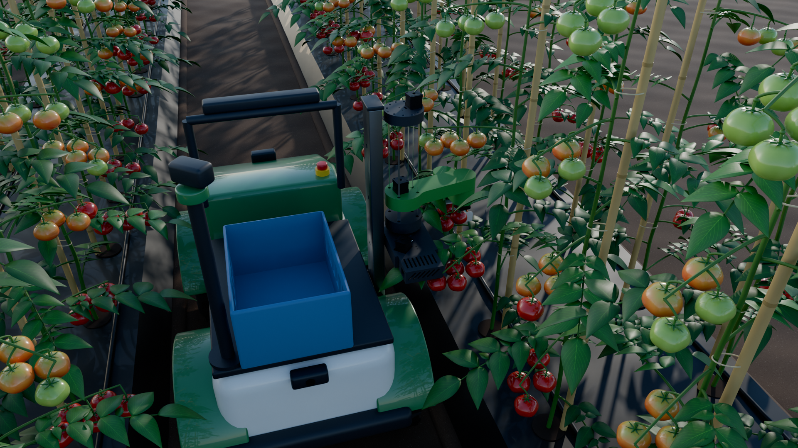
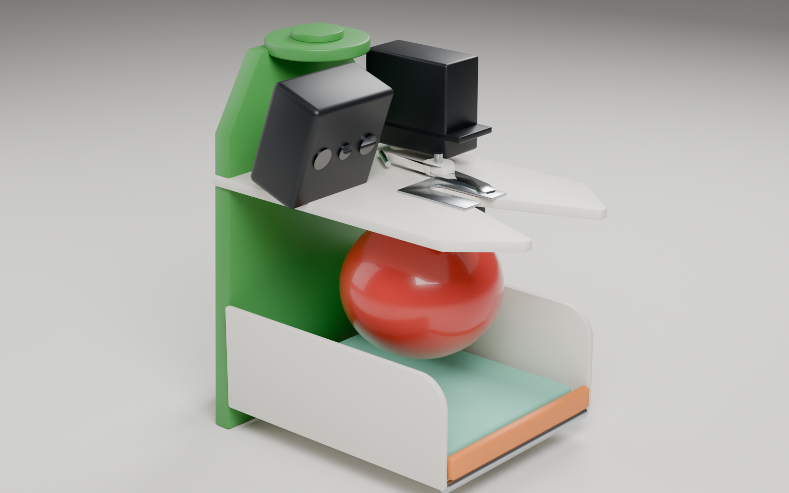
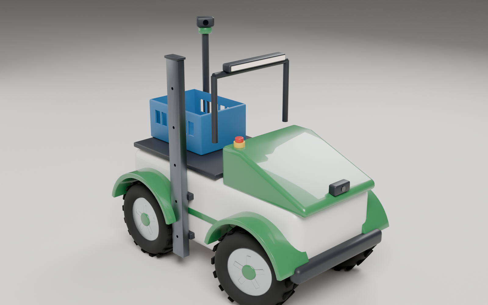
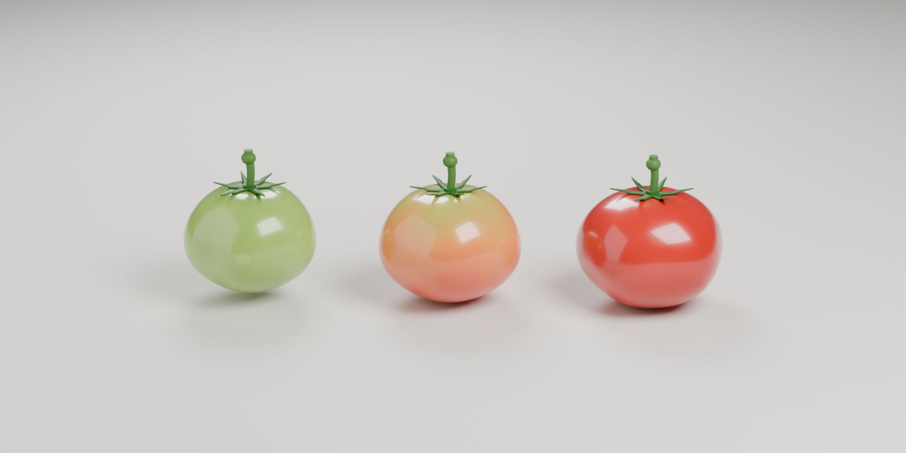
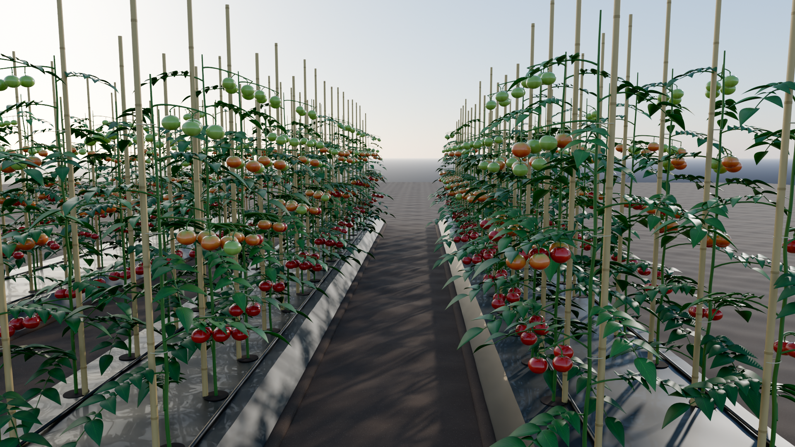

# Simulation assets

Created 31 Oct 2026 on Windows (Blender 5.1, Python 3.11). This covers every model and mesh the simulation uses: what it is, where its numbers come from, how to rebuild it, and how it was checked.

Every asset comes from a script in `tools/`. Change the script and rebuild; do not hand-edit generated files.



## Contents

| Asset | Package path | Source of truth |
| --- | --- | --- |
| SCARA arm, 5 links + stock gripper | `sim/agribot_description/meshes/scara/` | HowToMechatronics STEP, split by `tools/scara/extract_links.py` |
| V-capture tomato cutter (concept v0) | `sim/agribot_description/meshes/cutter/` | `tools/blender/build_cutter.py`, from [scara-redesign.md](scara-redesign.md) section 3 |
| Rover body, wheels, masts, crate | `sim/agribot_description/meshes/rover/` | `tools/blender/build_rover.py`, from the measurements in [work-plan.md](work-plan.md) section 1 |
| Robot description (URDF/xacro) | `sim/agribot_description/urdf/` | `tools/description/write_urdf.py` |
| Tomato fruit, three ripeness stages | `sim/agribot_field/models/tomato_{green,half,ripe}/` | `tools/blender/build_field.py` |
| Staked tomato plants, three variants | `sim/agribot_field/models/tomato_plant_{a,b,c}/` | `tools/blender/build_field.py` |
| Raised bed segment, soil tile | `sim/agribot_field/models/{raised_bed,soil_tile}/` | `tools/blender/build_field.py` |

## Conventions

- **Units and axes:** metres and radians. Every mesh is modelled with z up and x forward (the ROS convention).
- **Formats:**
  - **OBJ + MTL** (with PNG textures where used) for ROS and Gazebo. Written in raw z-up coordinates, so URDF and SDF use them with no rotation.
  - **GLB** for Unreal and any other glTF tool. It follows the glTF standard (y up); importers convert it back.
  - **STL** for collision meshes only.
- **Materials:** one shared palette (`tools/blender/agri_common.py`, `PALETTE`), so every asset matches.
- **Collision:** the rover and cutter collide with URDF boxes and cylinders, not meshes. The SCARA uses one convex hull per link. Plants collide only through their stem and stake, so the arm can push through leaves.
- **Marking:** every number in the URDF is marked as *measured*, *assumed* or *estimate*. Masses and inertias are estimates until the parts are weighed.

## SCARA arm

The STEP model is read with OpenCascade. Each part is assigned to a link and moved into that link's joint frame.

**Checks:**
- Forward kinematics at the STEP's own pose lands J3 and the gripper tip within **0.002 mm** of where the STEP has them. `build_scara.py` asserts this on every build.
- The joint geometry also matches the SolidWorks assembly (`SCARA Robot.SLDASM`).

| Quantity | Value | Source |
| --- | --- | --- |
| L1, J1 → J2 | 0.22798 m | STEP |
| L2, J2 → J3 | 0.13649 m | STEP |
| Z stroke | 0.249 m: 0.166 m down to the base cover, 0.083 m up to the top limit switch | STEP part clearances |
| J1, J2, J3 limits | ±170°, ±150°, ±150° | assumed; set from the home switches and cable routing |
| Effort and velocity | J1 2 N·m, Z 100 N, J2 3 N·m, J3 0.8 N·m | estimate from the procured motors and pulley ratios |
| Mass | base 0.83, column 1.81, carriage + Arm 1 0.95, Arm 2 0.57, wrist 0.04, stock gripper 0.26 kg | mesh volume × effective density; printed parts at 45% of solid PLA |

**Frames:**
- `base_link` sits on the J1 axis at the bottom of the base.
- At J1 = 0, Arm 1 points along +x.
- Z = 0 is the lowest carriage position.
- At J2 = 0, Arm 2 is straight in line with Arm 1.
- `tool_flange` is the J3 coupler underside, 18 mm below the wrist frame. Tools bolt on there.

**What's left out:** fasteners and the laser add-on.

**Visual meshes:**
- CAD facets are merged, then decimated to about 16–43k triangles per link.
- Bearings carry most of the triangles in the CAD, so they keep only 12% of theirs.

**Updated value:** the Z stroke was quoted as roughly 200 mm in [scara-redesign.md](scara-redesign.md). The CAD gives 249 mm.

### Source CAD

The SCARA base design is adapted from HowToMechatronics (see [CREDITS.md](../CREDITS.md)).

- **Committed:** the unpacked CAD in `media/scara-arm/` (layout in [internal/scara-arm-file-inventory.md](../internal/scara-arm-file-inventory.md)) and the meshes generated from it.
- **Not committed:** the original download zips, because they duplicate the unpacked files.

## Cutter (concept v0)

A simulation model of the V-capture bypass cutter in [scara-redesign.md](scara-redesign.md): 40 mm mouth, 6 mm throat about 64 mm ahead of the J3 axis, hooked bypass blade on an inverted MG996R, cradle for fruit up to about 75 mm, foam floor, servo-driven trap door, IR break-beam, and the RGB-D camera pitched down 20°.

It is not a manufacturing design. Wall thicknesses, fasteners and the blade linkage are indicative.



**URDF joints:**

| Joint | Range | Meaning |
| --- | --- | --- |
| `scara_cutter_blade_joint` | −70° to 0 | 0 = open |
| `scara_cutter_door_joint` | 0 to 75° | 0 = shut |

**Frames:**
- `scara_cut_point`: centre of the throat. It is also `scara_tool0` when the cutter is fitted.
- `scara_arm_camera_link` plus an optical frame.

## Rover

There is no CAD for the ride-on car, so the body is a clean stylised shell built at the measured size.

| Quantity | Value | Status |
| --- | --- | --- |
| Length, width over tyres, height | 1.20 × 0.70 × 0.80 m | measured (10 Oct 2026) |
| Seat / deck height | 0.50 m | measured |
| Tyres | 0.38 m × 0.15 m | measured |
| Wheelbase, track | 0.72 m, 0.55 m | **assumed** (work-plan section 1) |
| Steering | one revolute joint, ±25°, parallel steer | **assumed** until the linkage is seen |
| Chassis mass | 30 kg | **estimate** |



**Frames:**
- `base_footprint` on the ground.
- `base_link` midway between the axles, at axle height.
- `steer_link` on the front axle.
- Four wheel joints.
- `front_camera_link` and `rear_camera_link`, each with an optical frame.
- `imu_link`.
- `scout_mast` → `scout_pan_joint` → `scout_camera_link`.
- `harvest_crate`.
- `scara_mast`.

**SCARA mast:**
- A vertical 80 × 40 rail on the right side (−y), bracketed to the body.
- It has five pin positions, 0.18 m apart. The SCARA base sits 0.18, 0.36, 0.54, 0.72 or 0.90 m above the ground (xacro arg `mast_pin`, default 2).
- This is the prototype answer to the height problem in [scara-redesign.md](scara-redesign.md) section 4.
- The SCARA base's long side runs along the body toward the rear. A first version pointed it outward, which put the electronics box exactly where the fruit hangs.

## Tomato field

Procedural and seeded: a rebuild gives the same assets.



**Fruit** (`tomato_green`, `tomato_half`, `tomato_ripe`):

| Model | Diameter | Mass |
| --- | --- | --- |
| `tomato_green` | 56 mm | 80 g |
| `tomato_half` | 60 mm | 90 g |
| `tomato_ripe` | 62 mm | 95 g |

The sizes follow the Indian figures in [scara-redesign.md](scara-redesign.md), such as Arka Rakshak at 80–100 g.

Each fruit has:
- five lobes and a stem cavity
- a six-sepal calyx
- the 12 mm distal pedicel and the knuckle (abscission zone)

**Model origin is the knuckle.** The world attaches each fruit to its plant there with a detachable joint, and cutting releases it. The SDF also has a `cut_point` frame halfway down the pedicel. Collision is a sphere at 95% of the radius.

**Plants** (`tomato_plant_a/b/c`):
- Leaflets carry a generated texture (midrib, lateral veins, mottling, paler margins), in three green variants.
- Staked indeterminate plants, 1.25–1.5 m tall, tied to a bamboo stake with jute.
- Compound leaves with 4–5 pairs of serrated leaflets, plus small interstitial leaflets.
- A truss every third node, facing the plant's −y side (the harvest face). Trusses ripen from the bottom up, as real plants do.
- Fruit are not part of the plant mesh. Each plant has a `fruit_sites.json` listing every knuckle pose (plant frame) and its ripeness. The world spawns fruit models there.

**Beds** (`raised_bed`):
- Segment size: a 2.7 m segment that tiles along x.
- Cross-section: top 0.90 m, base 1.10 m, height 0.15 m.
- Surface: wrinkled black plastic mulch, soil berms, planting holes, two drip lines.
- Plant lines at ±0.30 m from the bed centre, with plants 0.45 m apart.
- Furrows are 0.90 m and the bed pitch is 2.00 m, so the 0.70 m rover drives the furrow and the plant line sits about 0.27 m from the J1 axis. That's within the 0.36–0.42 m reach.
- Layout: `sim/agribot_field/config/field_layout.json`.

**Semantic labels** for a segmentation camera: `sim/agribot_field/config/semantic_labels.yaml`.



## Rebuilding

From the repository root on Windows:

```bash
python -m venv .venv
.venv/Scripts/python -m pip install -r tools/requirements.txt
```

```bash
.venv/Scripts/python tools/scara/extract_links.py
```

```bash
"/c/Program Files/Blender Foundation/Blender 5.1/blender.exe" -b --factory-startup --python tools/blender/build_scara.py
```

```bash
"/c/Program Files/Blender Foundation/Blender 5.1/blender.exe" -b --factory-startup --python tools/blender/build_cutter.py
```

```bash
"/c/Program Files/Blender Foundation/Blender 5.1/blender.exe" -b --factory-startup --python tools/blender/build_rover.py
```

```bash
"/c/Program Files/Blender Foundation/Blender 5.1/blender.exe" -b --factory-startup --python tools/blender/build_field.py
```

```bash
.venv/Scripts/python tools/description/write_urdf.py
```

```bash
"/c/Program Files/Blender Foundation/Blender 5.1/blender.exe" -b --factory-startup --python tools/blender/render_hero.py
```

**Order matters:** extract → build_scara → build_cutter and build_rover → write_urdf. The field and hero steps are independent of the arm, except that the hero render needs the SCARA meshes. On Ubuntu, use `blender` and `python3` in place of the Windows paths.

## How it was checked

- **Asset QA:** `tools/qa/check_assets.py` runs over every mesh. It checks:
  - every file parses
  - no NaN coordinates
  - fewer than 0.5% zero-area triangles
  - sizes plausible in metres
  - normals present
  - material and texture files exist, with relative paths (so they work on Linux)
  - GLB files are valid with embedded textures
  - every `package://` and `model://` reference resolves

  Result on 31 Oct 2026: 29 meshes, 0 warnings, 0 failures.
- **SCARA kinematics:** forward kinematics against the STEP, to 0.002 mm (automatic on every build).
- **URDF structure:** `write_urdf.py` checks every generated URDF has one root, no link with two parents, and every mesh file present.
  - Full robot: 31 links, 30 joints.
  - Arm alone: 9 links, 8 joints.
- **xacro:** expanded with the `xacro` processor for both tools.
  - Cutter at mast pin 2: 31 links.
  - Stock gripper at pin 4: 26 links.
- **Visual check:** the hero renders pose the robot from `agribot.urdf` through its own forward kinematics, with an IK solve that puts the cutter throat on a real fruit's pedicel. If a frame were wrong, it would show.

**Not yet checked (needs Ubuntu with ROS 2 Humble and Gazebo):**
- `colcon build` of the two packages
- `display.launch.py` in RViz
- loading the models in Gazebo
- physics tuning
- Gazebo plugins: `ros2_control`, cameras, detachable joints, labels. These belong in a world and control package that does not exist yet.
