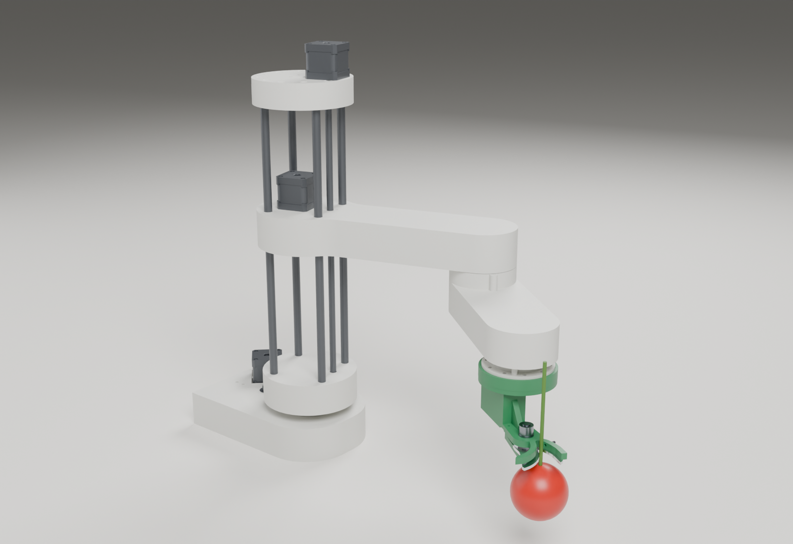
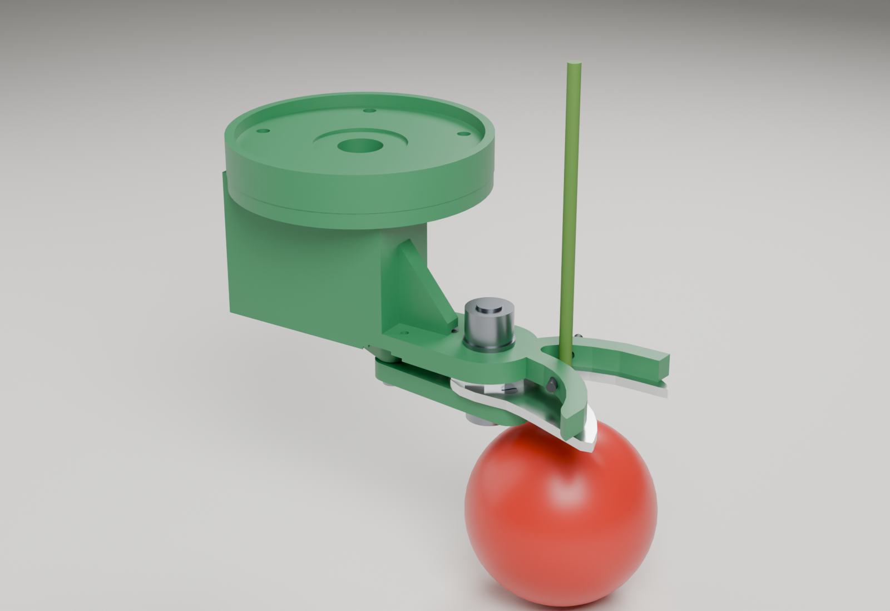
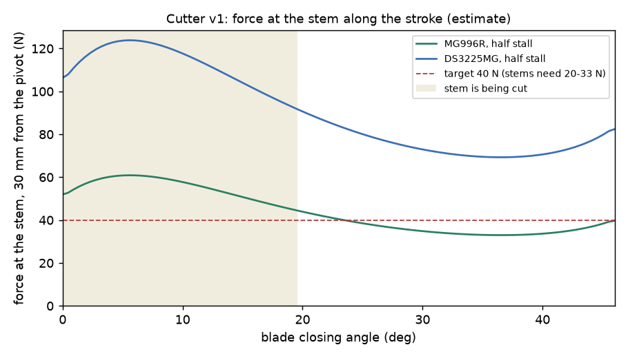
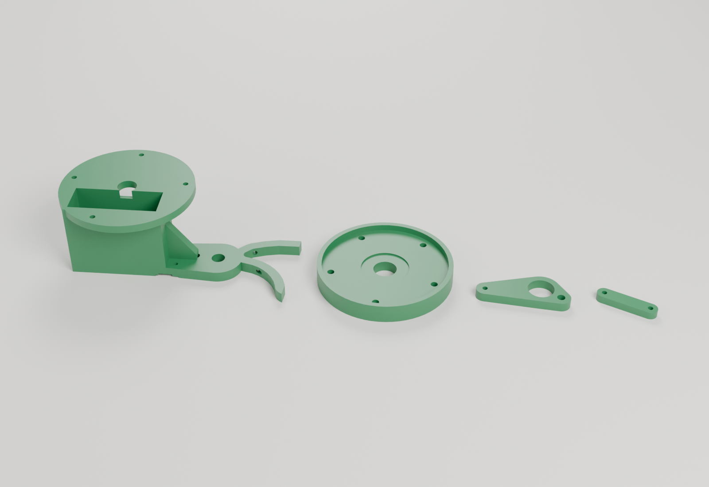

# Stem cutter v1 for the stock SCARA

Designed 15 Nov 2026 for the arm being built: the stock HowToMechatronics SCARA (L1 228 mm, L2 136.5 mm). The arm v2 in [arm-v2-design.md](arm-v2-design.md) is a design study and is not what is being printed.

**Status:**
- CAD done and checked; nothing bought or printed yet.
- **The blades are not bought yet.** Their sizes are scaled from the listing photo. Re-measure and rebuild before printing the body (section 9).
- This tool only cuts. A fruit catcher comes later and bolts onto the deck.

Every number is tagged **[M]** measured (stock STEP or STL, a datasheet, the listing or a paper), **[A]** assumed (a design choice or an unchecked value) or **[E]** estimate (worked out or scaled from the photo; replace it with a measurement).

**Interactive 3D view:**
1. Run `tools/cad/build_cutter.py` and `tools/cad/export_stock_arm.py`.
2. Serve the repo root with `.venv-cad/Scripts/python -m http.server 8765` (or the `arm-viewer` preview).
3. Open `http://localhost:8765/tools/cad/viewer/?set=cutter`.

Hover over a part for its name, and click a part to show it alone.

**Files:**
- `tools/cad/cutter_geometry.py`: every number
- `tools/cad/cutter_calcs.py`: blade cut window, linkage search, forces. Writes `cad/cutter/calcs.json` and the force plot.
- `tools/cad/build_cutter.py`: the CAD
- `tools/cad/check_cutter.py`: collisions over the stroke, stem and fruit clearance, the IR beam, a full J3 turn under the stock Arm 2, print-bed fit
- `tools/cad/sw_cutter.py`: brings the parts into SolidWorks through the solidworks-automation skill. It saves parts and assemblies in `cad/cutter/solidworks/` (not committed) and runs SolidWorks interference detection.
- `tools/cad/render_cutter.py`: renders
- `tools/cad/export_stock_arm.py`: exports the stock arm for the viewer and the on-arm render (third-party geometry, not committed)
- Output in [cad/cutter](../cad/cutter):
  - `stl/`: the four printed parts, ready to slice
  - `step/`: the same parts as STEP
  - `cutter_open.step`, `cutter_closed.step`: the whole tool
  - `cutter_on_stock_arm.step`: the tool under the stock J3 coupler, in the stock STEP frame
  - `parts.csv`: part list
  - `calcs.json`: forces

## 1. How it works

It is a battery pruning shear without its handles. The hook blade is bolted to the tool. The moving blade turns on a steel pivot and is closed by one servo through a link and a lever.

1. The camera finds the fruit and the stem above it. **J3** turns the open jaws to face the stem.
2. The arm moves in sideways. The stem slides down the guide arms and the hook into the throat and breaks the IR beam. The arm stops.
3. The servo closes the blade in small steps over 1–2 s. The hook holds the stem while the blade slices across it.
4. The beam clears, which confirms the cut. The fruit drops; for now, test over a tray.
5. The blade opens and the arm backs out.

**Degrees of freedom:** one, open and close. The arm gives x, y and z, and J3 aims the jaws. Stems hang roughly vertical, so the blades cut in a horizontal plane and no wrist pitch is needed.

## 2. Mounting on the stock J3 coupler

Measured from the stock `J3 Coupler` (STEP and STL) [M]:
- Ø78.0 flange, 7 mm thick
- 10 × Ø4.1 holes on a 67.5 mm circle, every 36°
- Ø12.5 centre bore for cables
- 4 × M4 pulley-screw heads on a 22 mm circle, in counterbores

The tool plate (C-01):
- **Centring:** a skirt rises 4 mm round the flange (Ø78.4 inside), so the tool centres on J3 by itself, not on bolt slop.
- **Bolts:** 5 × M4 × 16 up through every second coupler hole (72° apart), with nuts on top of the flange as in the stock design. The heads sit in counterbores under the plate.
- **Recesses:** a Ø30 × 1 mm relief clears the pulley-screw heads, and a Ø14.5 hole lines up with the cable bore.

The body (C-02) hangs from the plate on 4 × M3 screws, driven from below into heat-set inserts in the plate. The screw positions are chosen clear of the tower so a key reaches them.

**Order:** bolt the plate to the coupler first, then the body to the plate.

## 3. The blades [listing photo]

A replacement blade set for a battery pruning shear. The listing gives:
- 70 mm long [M]
- 25 mm cutting capacity [M]
- Ø16 pivot hole [M]
- Ø5 drive hole on the moving blade [M]

Everything else is scaled from the photo at 0.071 mm/px [E]:

| | Value |
| --- | --- |
| Thickness, each blade | 3.0 mm [A] |
| Drive hole from the pivot | 13.9 mm [E] |
| Tail hole on the hook blade | Ø5 [A], 14.4 mm from the pivot [E] |
| Where a 4 mm stem seats in the throat | 23.6 mm from the pivot [E] |
| Blade rotation from first contact to the stem cut through | 0.9° to 11.6° [E] |
| Moving tip passes the hook edge at | 40°; the stroke is 46° [E] |

**The cut happens in the first 12° of the closing stroke.** So the drive is laid out to give its highest leverage at the start of the stroke, not near toggle at the end.

**Fixing:** the hook blade is held by two points:
- the pivot
- a Ø5 × 10 dowel pressed through the deck into its tail hole

The dowel stops flush, so nothing sticks into the moving blade's plane.

## 4. The drive

| | Value |
| --- | --- |
| Servo | MG996R (on hand). A DS3225MG has the same case and drops in. |
| Linkage | Servo horn (14 mm hole) → printed link, 29 mm → printed lever, 34 mm from the pivot. The lever is pinned to the moving blade by a Ø5 × 8 dowel in the blade's drive hole. |
| Horn travel | 138° for the 46° blade stroke [E]. Use a 500–2500 µs pulse range. |
| Leverage in the cut window | At least 3.0 : 1 (horn angle per blade angle) [E] |
| Force at the stem, half stall | **MG996R: at least 45 N. DS3225MG: at least 92 N** [E] |
| Target | 40 N. Stems need 19.6–33.0 N for 3–4 mm pedicels [M, Weng 2024] |

The force is worked out at 29.6 mm from the pivot, which allows for the stem sliding 6 mm outward along the hook as the blade closes. It is reduced by:
- pin friction (90% efficiency) [A]
- 0.15 N·m of pivot friction [E]

The linkage was chosen by a search in `cutter_calcs.py`. The search maximised the leverage over the cut window and kept these limits:
- transmission at least sin 0.45 at the lever and sin 0.15 at the horn, with no dead point in the stroke
- the link clear of the blade tails
- the servo inside the plate

**The MG996R margin is small (45 N against 40 N).** If it stalls on real stems, fit the DS3225MG. Run the servo from the 6 V servo buck, not the logic rail: a stalled MG996R draws over 2 A.

## 5. The stack at the pivot

From the top:

| z (tool frame, mm) | Part |
| --- | --- |
| −37.4 to −49 | M8 nyloc, spring washer, washer on top of the deck |
| −49 to −56 | Deck (C-02) |
| −56 to −59 | Hook blade, fixed |
| −59 to −62 | Moving blade (the shear plane is at −59) |
| −62 to −68 | Lever (C-03), turning with the moving blade |
| −68 to −74 | Washer and M8 × 35 button-head bolt |

- **Pivot:** a steel bush (OD 16, ID 8, 11.9 long) runs through both blades and the lever. It is 0.1 mm shorter than the stack, so tightening the nut presses the blades together. That pressure keeps the shear gap closed; a printed part only locates the blades.
- **Preload:** snug the nut until the blade closes without a gap at the tip, then back off until the servo moves it freely. Grease the blade faces lightly.
- **Bolt the right way up:** the bolt head goes under the lever because the fruit hangs below the blades. A nut stack there would hit fruit whose top is less than about 11 mm below the cut.

**Fruit clearance:** a 40, 60 or 85 mm fruit whose top is 14 mm below the shear plane clears the tool, open and closed (checked). Aim the cut about 15 mm above the fruit top. A longer stem stub can be trimmed after harvest.

## 6. Other features

- **Stem guide arms:** the deck reaches forward as two arms either side of the jaws, 3 mm outside the blade edges. The moving blade passes under them. The mouth between the arm tips is about 37 mm, so the arm can miss the stem by about ±15 mm and the stem still slides in.
- **Throat sensor:** a 3 mm IR LED and a 3 mm IR phototransistor, one in each arm, face each other across the throat. The stem breaks the beam when it is seated. The beam is not blocked by the open blades (checked).
- **Catcher mounting:** two Ø2.5 pilot holes in the deck top take M3 self-tapping screws for a future fruit catcher.
- **Clearances:** pockets in the body clear the horn, its pin head and the link's path.

## 7. Parts and printing

| Id | Part | Size, mm | Mass [E] | Print |
| --- | --- | --- | --- | --- |
| C-01 | Tool plate | 84 × 84 × 12 | 34 g | PETG, bottom face down, 5 walls, 40% gyroid |
| C-02 | Body: servo tower, deck, guide arms | 147 × 84 × 48 | 43 g | PETG, deck face down (it seats the hook blade), 5 walls, 40% gyroid. Supports only under the top flange and in the horn pocket. |
| C-03 | Lever | 57 × 24 × 6 | 6 g | PETG 100%, flat |
| C-04 | Link | 36 × 19 × 5 | 2 g | PETG 100%, flat |

The whole tool weighs about 250 g with the servo, blades and hardware [E]. The stock gripper weighed 150–200 g. The tool hangs 74 mm below the flange (the stock gripper hung 115 mm). Its stem throat is 80 mm from the J3 axis, so the stem stays well clear of Arm 2.

**Fits:**
- The dowel holes are Ø4.9 for a press fit.
- The Ø16.2 lever hole runs on the bush.
- Print a test piece of the lever's pivot end first and check the bush turns freely.

## 8. Checks (`check_cutter.py`)

- **Stroke:** no part touches another over the full stroke, open to closed, every 2°. The pins, dowels and pivot bush are allowed to touch the parts they hold.
- **Stem:** a vertical 4 mm stem through the throat touches nothing with the jaws open.
- **Fruit:** 40, 60 and 85 mm fruit, tops 14 mm below the cut, clear the tool.
- **Beam:** the IR beam crosses the seated stem.
- **Stock Arm 2:** the tool turned through a full J3 turn (every 15°) clears the stock Arm 2, its cover, the J3 bearings and pulley, the 400 mm belt, the pancake motor and the J3 home switch, all from the stock STEP.
- **Bed:** every printed part fits the Kobra S1 bed.
- **SolidWorks:** interference detection on the open and closed assemblies (`sw_cutter.py`) agrees.

**Not checked:**
- No FEA.
- The blade outlines are traced from a photo.
- The servo torque is a datasheet figure.
- The J2 fold against the Z column with this tool is not checked. The tool is shorter than the stock gripper, so it should be no worse.

## 8b. Running it before the blades arrive

Print the four parts in section 7, plus these stand-ins from `cad/cutter/stl/test/` (PETG, 100%, flat):

| Id | Stand-in for |
| --- | --- |
| T-90 | Hook blade (same outline and holes, 3 mm) |
| T-91 | Moving blade |
| T-92 | Steel pivot bush (OD 16, ID 8.2) |
| T-93 | Ø5 × 8 drive dowel |
| T-94 | Ø5 × 10 tail dowel |

The tool then assembles and runs exactly as it will with steel. That tests:
- the mount on J3
- servo travel and the horn angles
- the linkage
- the IR beam
- the arm's approach to a stem

The stand-in blades do not cut. When the steel set arrives:
1. Measure it (section 9).
2. Rebuild, and reprint the body if the numbers changed.
3. Swap in the steel blades, bush and dowels.

## 9. When the blades arrive

Measure, then update `cutter_geometry.py`, run `cutter_calcs.py --search` if the drive hole moved, rebuild and re-run the checks:

1. Thickness of each blade (`BLADE_T_FIXED`, `BLADE_T_MOVING`).
2. Drive hole and tail hole: their diameters, and their distances and angles from the pivot centre (`DRIVE_HOLE`, `TAIL_HOLE`, `TAIL_HOLE_D`).
3. Both outlines: photograph each blade flat on squared paper, straight down, and trace them again (`FIXED_OUTLINE`, `MOVING_OUTLINE`).
4. Whether the set comes with its own pivot bolt and bush. If it does, measure it. The design assumes a separate OD 16 / ID 8 bush on an M8 bolt.

## 10. Assembly

1. Press the M3 inserts into the plate. Bolt the plate under the J3 coupler (5 × M4 × 16, nuts on top of the flange).
2. Press the tail dowel into the deck from the top, until 2.8 mm stands out below.
3. Press the drive dowel into the lever, until 2.8 mm stands out above.
4. Servo into the tower from the top, tabs on the ledge, with its own screws. Horn on at the open angle (section 4: 140° open, 2° closed in the tool frame). Drill the horn hole to 3.2 mm.
5. Pivot stack: bolt up through the washer, lever, moving blade (on the drive dowel) and hook blade (on the tail dowel), with the bush inside. Then through the deck, and washer, spring washer and nyloc on top. Set the preload (section 5).
6. Link: M3 × 12 through the horn and link, nyloc under the link; M3 × 16 through the link and lever, nyloc under the lever.
7. IR LED and phototransistor into the arm holes, wires along the deck to the tower.
8. Body onto the plate (4 × M3 × 10 from below).

## 11. To buy

| Item | Qty | Est. price |
| --- | --- | --- |
| Pruner replacement blade set, 70 mm, Ø16 pivot (the listing found) | 1 | ₹300–800 |
| Steel bush OD 16 × ID 8, cut to 11.9 mm (or the set's own pivot sleeve) | 1 | ₹50–150 |
| M8 × 35 button-head bolt, 2 × M8 washer, M8 spring washer, M8 nyloc | 1 set | ₹50 |
| Dowel pins Ø5 × 8 and Ø5 × 10 (or M5 bolt shanks cut to length) | 1 each | ₹50 |
| 3 mm IR LED + 3 mm IR phototransistor | 1 pair | ₹30 |
| M3 × 12, M3 × 16, 2 × M3 nyloc, 4 × M3 × 10, 4 × M3 heat-set inserts | 1 set | ₹100 |
| 5 × M4 × 16 + 5 × M4 nuts | 1 set | ₹30 |
| DS3225MG servo (only if the MG996R stalls) | 0–1 | ₹1,300–1,800 |

Prices are rough Indian online-store estimates [E].
