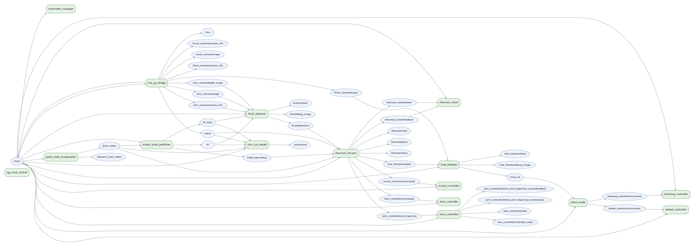

# ROS 2 snapshot: autonomy and simulation split (1 Nov 2026)

Taken on the Ubuntu laptop (RTX 4060, ROS 2 Humble, Gazebo Fortress 6.18) after the autonomy nodes moved into their own package. Graph, node list and rates come from a headless run with `picks:=1` (`done: 1 of 1 picks verified in the crate`); the harvest table comes from the filmed run with `picks:=3`. `tools/sim/ubuntu/stop.sh` ran before each, so no stale nodes were alive. How the parts fit together is explained in [ros-architecture.md](../../ros-architecture.md).



## Nodes

```
/arm_controller
/controller_manager
/drive_node
/fruit_detector
/gz_ros2_control
/harvest_client
/harvest_mission
/joint_state_broadcaster
/robot_state_publisher
/ros_gz_bridge
/row_follower
/scout_controller
/sim_cut_model
/steering_controller
/tool_controller
/wheel_controller
```

`harvest_client` exits once its goal finishes. `film_director` and `capture_frames` start only when `capture_dir` is set, so they are absent from this headless run.

## Controllers

```
joint_state_broadcaster joint_state_broadcaster/JointStateBroadcaster          active
wheel_controller        velocity_controllers/JointGroupVelocityController      active
steering_controller     position_controllers/JointGroupPositionController      active
arm_controller          joint_trajectory_controller/JointTrajectoryController  active
tool_controller         position_controllers/JointGroupPositionController      active
scout_controller        position_controllers/JointGroupPositionController      active
```

## Actions and services

```
/harvest       agribot_interfaces/action/Harvest                  harvest_client -> harvest_mission
/crate/verify  agribot_interfaces/srv/VerifyPick                  harvest_mission -> sim_cut_model
/arm_controller/follow_joint_trajectory  control_msgs/action/FollowJointTrajectory
```

## Rates (measured with `ros2 topic hz`, simulation running headless)

| Topic | Rate |
| --- | --- |
| `/clock` | 446.9 Hz |
| `/joint_states` | 86.5 Hz |
| `/odom` | 26.0 Hz |
| `/tf` | 17.9 Hz |
| `/front_camera/image` | 8.2 Hz |
| `/arm_camera/image` | 7.1 Hz |
| `/arm_camera/depth_image` | 5.3 Hz |
| `/row_follower/state` | 9.4 Hz |
| `/fruit/detections` | 8.1 Hz |
| `/harvest/status` | 1.8 Hz |

`/cmd_vel` measured nothing: the topics were sampled one after another, and by the time `/cmd_vel` was sampled the rover had stopped for its fruit, with the row follower switched off. `/harvest/status` publishes at 2 Hz and on every state change. The camera figures are lower bounds, because `ros2 topic hz` (Python) cannot deserialise full images as fast as they arrive.

## Harvest (from the filmed `picks:=3` run)

| Pick | Stop (fruit seen, rover frame, m) | Confirmed | Fruit cut (`sim_cut_model`) | Pedicel from the throat | Result |
| --- | --- | --- | --- | --- | --- |
| 1 | (0.093, −0.483, 0.829) | 5 frames, 1 fruit | `plant_b0_r0_t1_f2`, ripe | 16 mm | in the crate |
| 2 | (0.051, −0.498, 0.789) | 11 frames, 1 fruit | `plant_b0_r1_t1_f3`, ripe | 7 mm | in the crate |
| 3 | (0.068, −0.476, 0.832) | 8 frames, 2 fruit | `plant_b0_r2_t1_f3`, half-ripe | 13 mm | in the crate |

On every pick the throat reached the estimated pedicel to within 0.1 mm (forward kinematics of the measured joints). The pedicel distance is the cut model's measurement against the world file, which the mission never reads. The model accepts a cut within 30 mm. Final line of the log: `done: 3 of 3 picks verified in the crate`.
