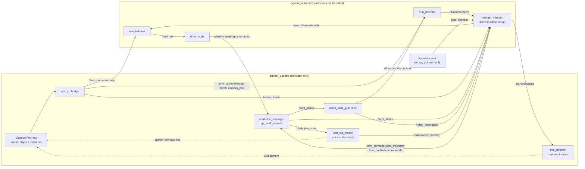
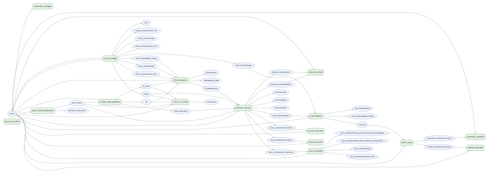
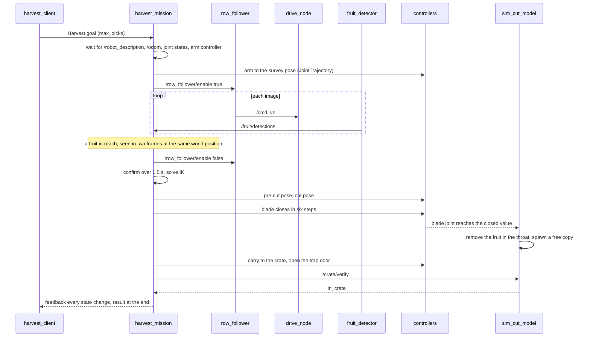

# How ROS 2 runs AgriBOT

This is the guide to the ROS 2 side of the project: which packages and nodes exist, what they say to each other, how a harvest unfolds as messages, and what each part does when something goes wrong. The simulation results are in [simulation.md](simulation.md).

The design rule: **the autonomy stack does not know it is in a simulator.** It uses cameras, joint states, odometry, TF and the robot description, and it commands controllers by topic. Everything that only exists because Gazebo cannot do it (cutting a stem, looking into the crate, moving the film camera) lives in a separate package.

## The picture



A drawing of the live graph, taken from the running system: 

## Packages

| Package | Type | Contents | Depends on |
| --- | --- | --- | --- |
| `agribot_interfaces` | ament_cmake, rosidl | `RowState`, `HarvestStatus`, `VerifyPick`, `Harvest` action | std_msgs, geometry_msgs |
| `agribot_autonomy` | ament_python | row follower, fruit detector, drive node, harvest mission, client; `config/autonomy.yaml`; `launch/autonomy.launch.py` | `agribot_interfaces` and standard ROS packages. No Gazebo. |
| `agribot_gazebo` | ament_cmake | world, bridge and controller config, robot spawn, `sim_cut_model`, `film_director`, `capture_frames`; `sim.launch.py`, `demo.launch.py` | the two above, `agribot_description`, `agribot_field`, ros_gz, gz_ros2_control |
| `agribot_description` | ament_cmake | URDF/xacro, meshes (generated by `tools/`) | |
| `agribot_field` | ament_cmake | tomato, plant and bed models | |

## Nodes

| Node | Package | Does | Subscribes | Publishes |
| --- | --- | --- | --- | --- |
| `row_follower` | autonomy | Finds the furrow in the front image and steers along it, while enabled | `/front_camera/image`, `/row_follower/enable` | `/cmd_vel`, `/row_follower/state`, `/row_follower/debug_image` |
| `fruit_detector` | autonomy | Finds red blobs in the arm camera, ranges them with depth, puts them in the rover frame with TF | `/arm_camera/image`, `/arm_camera/depth_image`, `/arm_camera/camera_info`, `/tf` | `/fruit/detections`, `/fruit/markers`, `/fruit/debug_image` |
| `drive_node` | autonomy | Turns `cmd_vel` into steering angles and four wheel speeds; stops the wheels if commands stop | `/cmd_vel` | `/wheel_controller/commands`, `/steering_controller/commands` |
| `harvest_mission` | autonomy | Runs a harvest: survey, drive, stop, confirm, pick, carry, drop, verify | `/robot_description`, `/odom`, `/joint_states`, `/fruit/detections` | `/arm_controller/joint_trajectory`, `/tool_controller/commands`, `/scout_controller/commands`, `/row_follower/enable`, `/harvest/status`, `/harvest/phase`, `/harvest/count`; serves action `/harvest`; calls `/crate/verify` |
| `harvest_client` | autonomy | Sends one Harvest goal, prints progress, exits with the outcome | action `/harvest` | |
| `sim_cut_model` | gazebo | Cuts the fruit whose stem is in the throat when the blade closes; answers whether the cut fruit is in the crate | `/joint_states`, `/odom`, `/tf` | `/sim/events`; serves `/crate/verify` |
| `film_director`, `capture_frames` | gazebo | Moves the GUI camera and saves camera images at fixed moments (only when `capture_dir` is set) | `/harvest/status`, `/odom`, `/capture`, camera topics | `/capture` |
| `controller_manager` + 6 controllers | ros2_control | joint state broadcaster; wheel (velocity), steering, arm (trajectory), tool, scout (position) | command topics | `/joint_states` |
| `robot_state_publisher` | | URDF to TF | `/joint_states` | `/tf`, `/tf_static`, `/robot_description` |

## Interfaces

### Messages, service, action (`agribot_interfaces`)

| Interface | Fields | Used for |
| --- | --- | --- |
| `msg/RowState` | `header`, `near`, `far` (half-widths from the image centre, +right), `confidence` 0..1, `tracking` | What the row follower sees in each image |
| `msg/HarvestStatus` | `state` (IDLE, STARTING, DRIVING, CONFIRMING, APPROACHING, ENGAGING, CUTTING, CARRYING, DROPPING, DONE, FAILED, CANCELED), `detail`, `attempts`, `verified`, `focus` (world point of interest) | Progress, for UIs, loggers and the film director |
| `srv/VerifyPick` | request empty; reply `in_crate`, `detail` | Asking whoever can see the crate whether the last cut fruit landed in it. A real robot would answer from a crate camera. |
| `action/Harvest` | goal `max_picks`, `max_distance`; result `success`, `attempted`, `verified`, `distance`, `message`; feedback `state`, `detail`, `attempts`, `verified`, `distance` | One harvest run |

### Topics

| Topic | Type | QoS | Notes |
| --- | --- | --- | --- |
| `/front_camera/image`, `/arm_camera/image`, `/arm_camera/depth_image`, `/arm_camera/camera_info` | `sensor_msgs` | sensor data (best effort) | Subscribers use the sensor profile, so they also connect to a real camera driver. Depth is 32FC1 in metres, `inf` or NaN where there is no return. |
| `/cmd_vel` | `geometry_msgs/Twist` | reliable, depth 10 | Only `linear.x` and `angular.z` are used. |
| `/odom` | `nav_msgs/Odometry` | reliable | Ground truth from Gazebo in the simulation. |
| `/robot_description` | `std_msgs/String` | transient local | The mission reads the URDF from here, so it has no file path to get wrong. |
| `/fruit/detections` | `geometry_msgs/PoseArray` | reliable, depth 5 | Fruit centres in `base_footprint`. The future ripeness model publishes the same message. |
| `/harvest/status` | `HarvestStatus` | transient local | Also repeated at 2 Hz, so a late subscriber gets the state. |
| controller commands | `std_msgs/Float64MultiArray`, `trajectory_msgs/JointTrajectory` | reliable | Order of the arrays is fixed by `config/controllers.yaml` and checked by tests. |

### Frames

`base_footprint` is the rover frame (x forward, y left, z up). The detector gives positions in it, and the mission solves inverse kinematics in it, so targeting needs neither a map nor odometry. The mission uses `/odom` (the world frame in the simulation) only to tell whether a detection in two frames is the same fruit, and how far the rover has driven. `scara_arm_camera_link_optical_frame` is the arm camera, found through TF.

## A harvest, as messages



## Parameters, configuration and launch

Every node declares its parameters in code with a type, a range and a description, and `config/autonomy.yaml` sets them all. A value outside its range stops the node at startup with the reason, and `ros2 param set` on a running node returns `successful: False` and keeps the old value. Cross-field mistakes (a window with low above high, a drop point that is not over the crate, a steering geometry that does not exist) stop the node as well.

| Launch file | Package | Starts |
| --- | --- | --- |
| `sim.launch.py` | gazebo | Gazebo, the robot, controllers (loaded one after another, each waiting for the previous), the bridge, `sim_cut_model`, optionally RViz |
| `autonomy.launch.py` | autonomy | `drive_node`, `row_follower`, `fruit_detector`, and with `harvest:=true` the mission and a client |
| `demo.launch.py` | gazebo | The two above, plus `film_director` and `capture_frames` when `capture_dir` is set |

`autonomy.launch.py` refuses to start on a missing, unparseable or incomplete parameter file instead of quietly using the defaults. Arguments:

| Argument | Default | Meaning |
| --- | --- | --- |
| `gui`, `rviz` | true, false | Gazebo window, RViz |
| `harvest` | false | Start the mission and send one goal |
| `picks` | 2 | Pick attempts in that goal |
| `max_distance` (autonomy only) | 0 | Metres of row; 0 uses the mission's `row_length` |
| `mast_pin` | 3 | SCARA mast pin, 0 to 4 |
| `params_file` | `config/autonomy.yaml` | Parameters of every autonomy node |
| `use_sim_time` (autonomy only) | true | Use `/clock` |
| `capture_dir` | empty | Save camera frames and direct the GUI camera for filming |

Useful commands, with the demo running:

```bash
ros2 action send_goal /harvest agribot_interfaces/action/Harvest "{max_picks: 2}" --feedback
ros2 topic echo /harvest/status
ros2 topic echo /row_follower/state
ros2 param get /row_follower speed
ros2 param set /row_follower speed 0.1
ros2 run agribot_autonomy harvest_client --picks 3
```

To run the autonomy stack on a real robot, launch only `autonomy.launch.py use_sim_time:=false` and provide the cameras, joint states, odometry, TF, the robot description, the controller command topics and `/crate/verify` (or leave the last out: picks are then reported as attempted but not verified).

## Concurrency and time

Image callbacks are short and each node is a single-threaded executor, except two. `harvest_mission` runs a multi-threaded executor with a reentrant callback group: the action's execute callback holds the mission and sleeps on the ROS clock while the subscriptions keep updating state from other threads. `sim_cut_model` does the same, because spawning a fruit takes seconds and must not stall the joint-state callback. The fruit detector gives its TF listener its own thread, so a transform lookup can wait without blocking images.

Every node honours `use_sim_time`. All waits in the mission are on the ROS clock, which is also why the mission tests can run it against a clock five times faster than real time.

## When things go wrong

| Situation | What happens |
| --- | --- |
| No front-camera image for 1 s while following | `row_follower` publishes one stop; `drive_node` has its own 0.5 s watchdog behind it |
| Furrow not visible (confidence below threshold) | The rover stops and waits; `RowState.tracking` is false |
| A corrupt or truncated image | Dropped with a throttled warning; the node keeps running |
| Camera info or transform missing | The detector skips the frame; with a transform only slightly older than the image it uses the newest one (up to `tf_max_age`) |
| `cmd_vel` with NaN or infinity | Ignored with a warning; it is never clamped into a full-speed command |
| `cmd_vel` stops | `drive_node` stops the wheels once after `cmd_timeout` and keeps the steering angle |
| Robot inputs missing at the start | The goal aborts after `startup_timeout`, naming what is missing |
| Rover not advancing for `stall_window` | The goal aborts ("no progress"), stops the row follower |
| Fruit unreachable | Only detections whose cut point is in the reach box are considered; inverse kinematics is the final judge and an unreachable one is skipped |
| Arm cannot reach the crate | The goal aborts with the error; the fruit is still in the cradle |
| `/crate/verify` missing or slow | The pick counts as attempted, not verified; the goal still succeeds |
| Second goal while one runs | Rejected |
| Cancel | The rover and follower stop; the goal ends CANCELED |
| Bad parameter file | `autonomy.launch.py` aborts with the reason; out-of-range values stop the node |

## Tests

```bash
python -m pytest sim/agribot_autonomy/test sim/agribot_gazebo/test        # anywhere: Windows, Linux, no ROS needed
```

With a sourced ROS 2 workspace the same command also runs the node, mission and launch tests (they are skipped otherwise). On the Ubuntu laptop: 338 tests, about 80 seconds.

| Test file | Covers |
| --- | --- |
| `test_steering.py` | Wheel speeds against rigid-body motion and the instantaneous centre of rotation; Ackermann angles against each wheel's own velocity; saturation, reversing, standstill, NaN, impossible geometry |
| `test_vision_row.py` | Furrow offsets against known geometry, mirror symmetry, resolution independence, no-furrow scenes, noise, jagged edges, unusable frames, two real simulator frames |
| `test_vision_fruit.py` | A rendered sphere's centre to within 2 mm at 0.3 to 0.7 m, partial occlusion, hue wraparound, range limits, missing or NaN depth, mismatched sizes, quaternion and frame maths, a camera at a known pose |
| `test_mission_logic.py` | Reach box, clustering and flicker rejection, steadiness in the world frame, stall watchdog |
| `test_robot_model.py` | The YAML against the URDF (wheelbase, track, wheel radius, steering limit, crate); every corner of the reach box and the survey, pre-cut and drop poses solvable by inverse kinematics; forward and inverse kinematics round trip |
| `test_nodes_ros.py` | Every node starts with the shipped YAML and every key in it is declared; out-of-range and inconsistent parameters stop a node; drive, row-follower and detector behaviour including watchdogs, bad input and TF fallback |
| `test_mission_ros.py` | The mission against a fake robot on a fast clock: a complete verified pick with the arm commanded to within 3 mm of the target, unverified picks, unreachable fruit, stall, cancel, rejected goals, a broken robot description |
| `test_launch_ros.py` | Launch arguments, the stack coming up and down cleanly, bad or missing parameter files |
| `test_consistency.py`, `test_world.py` (gazebo) | Bridge topics, controller names and joint order against the nodes and the URDF; fruit models carry the collision group the cut rewrites; the world file is well formed and the scenery stays clear of the rover |
| `test_cut_model.py`, `test_sim_cut_model_ros.py`, `test_shots.py` (gazebo) | Blade trigger with hysteresis, which fruit is in the throat, crate geometry, the node's cut and verify behaviour |

## Where ROS is simulated, and where it is real

| Real ROS 2 | Stand-in |
| --- | --- |
| All nodes, topics, services, the action, TF, parameters, launch | Gazebo physics and rendering |
| Controllers: `ros2_control` with the real controller types | Wheel and joint motors (stiff servos in the simulator) |
| Camera topics and their QoS | The cameras (rendered) |
| | Odometry (ground truth instead of wheel encoders and an IMU) |
| | The cut and the crate sensor (`sim_cut_model`) |

## Adding the ripeness model

Replace the colour rule in `agribot_autonomy/vision.py` (`red_mask`, `locate_blobs`) or add a node that publishes `/fruit/detections` with only ripe fruit. The mission reads nothing else from the detector, so the rest of the stack stays as it is.
