# Gazebo harvest demo

Recorded 1 Nov 2026 on the Ubuntu laptop (RTX 4060, Ubuntu 22.04, ROS 2 Humble, Gazebo Fortress 6.18).

The rover follows the furrow between two tomato beds using its front camera. Its arm camera looks at the fruit band beside it, and a detector turns red blobs plus depth into 3D fruit positions. When a fruit comes into reach the rover stops, confirms the detection over 1.5 s, and solves the arm pose for that point. The SCARA arm then brings the cutter's throat onto the pedicel and closes the blade, and the fruit drops into the padded cradle. The arm carries it to the crate on the rover's deck and opens the trap door. Gazebo reads back each fruit's position afterwards, and a pick counts only if the fruit is inside the crate.

No target comes from the world file. Navigation and targeting use only the robot's cameras, its joint states and odometry.

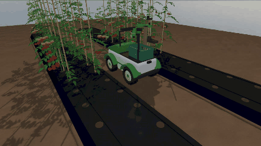

**Full run:** [media/agribot_demo.mp4](https://github.com/arjun7n9s/AgriBot/blob/main/docs/media/agribot_demo.mp4), 4 min 14 s at 1280×720, three picks.

| Drive | Approach | Cut |
| --- | --- | --- |
| 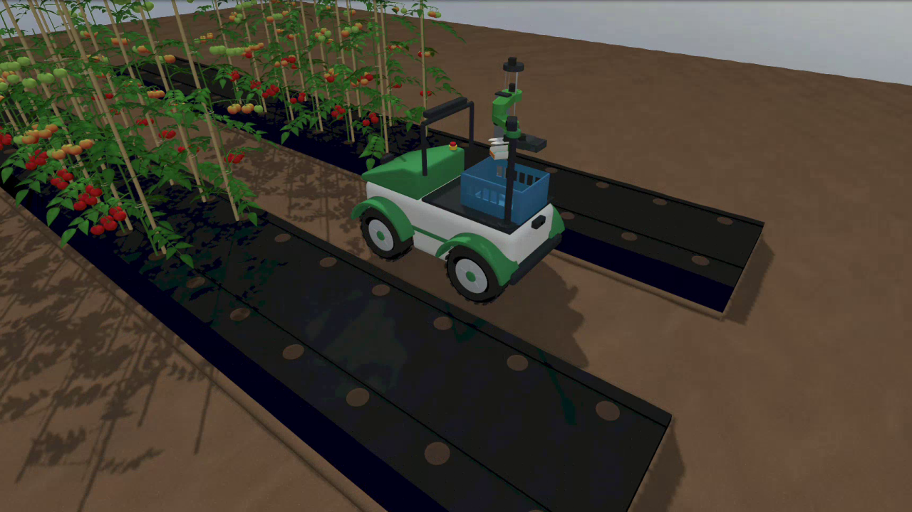 | 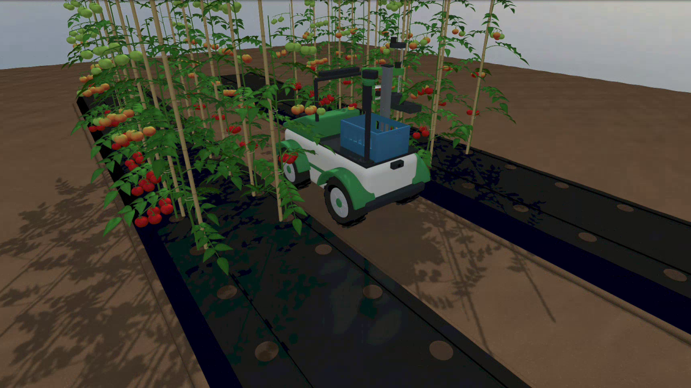 | 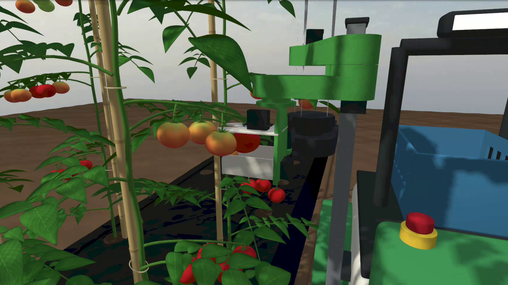 |

| Drop | Done |
| --- | --- |
| 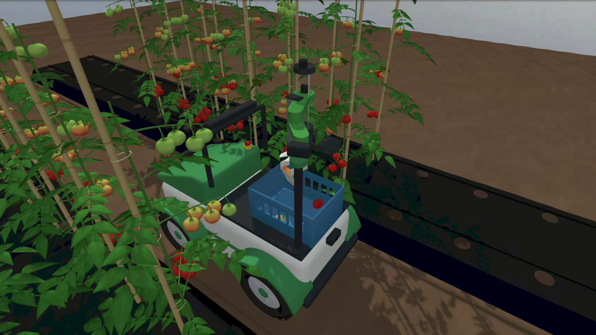 | 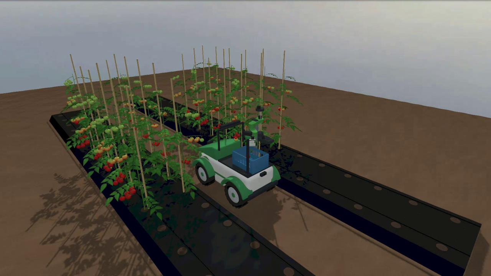 |

**What the robot saw** (ROS topics, saved by `capture_frames.py`):

| Row follower (`/row_follower/debug_image`) | Fruit detector (`/fruit/debug_image`) |
| --- | --- |
| 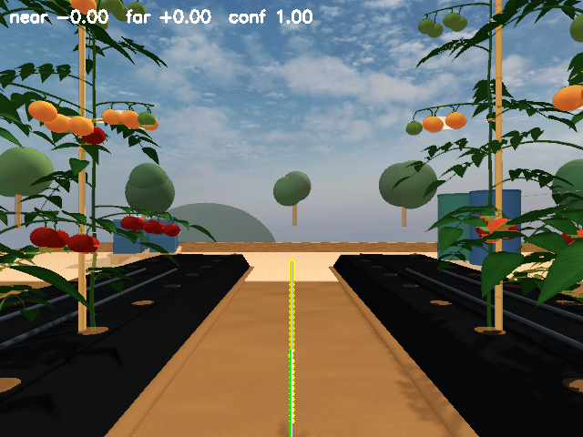 | 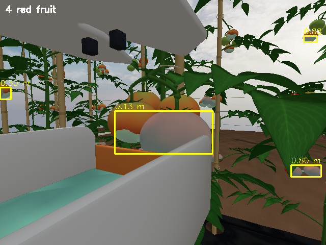 |
| Soil mask, run midpoints (yellow) and the fitted furrow line (green). Near and far offsets drive the steering. | Red pixels (cyan tint), one box per blob, with the depth-camera range. Half-ripe fruit show red undersides, so the colour rule picks them too. |

| Front (navigation) | Arm RGB-D: colour | Arm RGB-D: depth | Scouting (pan) |
| --- | --- | --- | --- |
| 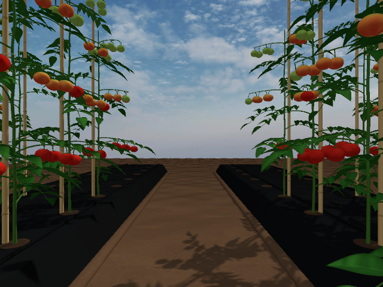 | 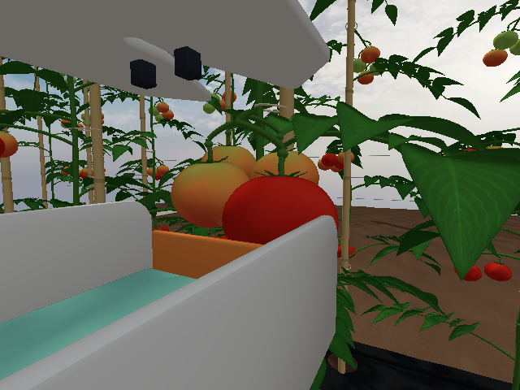 | 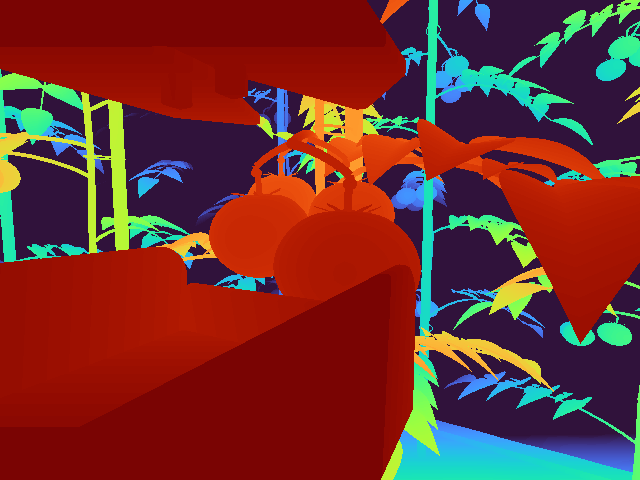 | 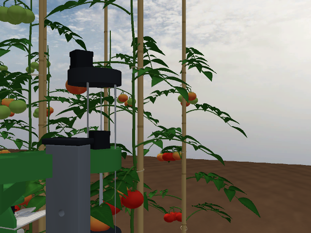 |

## Results

From a clean run (`picks:=3`, nothing else running). The full snapshot is in [media/ros2/ros2_report.md](media/ros2/ros2_report.md).

| | |
| --- | --- |
| Picks verified in the crate | **3 of 3** (fruit position read back from Gazebo) |
| What was picked | one ripe and two half-ripe fruit: the colour rule cannot tell them apart yet |
| Detection to pedicel | the estimate fell 6, 16 and 24 mm from the pedicel actually cut. The cut model accepts up to 3 cm; the real cutter's throat is 6 mm, so this must improve before the hardware |
| Cutter on the estimated pedicel | **0.1 mm**, measured: forward kinematics of the joint states |
| Detection steadiness | each fruit seen in 24 of 24 frames during the 1.5 s confirmation |
| Row following | from a 4° heading error, back to within about 1° in 2 s; sideways offset settles more slowly |
| Simulation speed | 0.91 × real time (clock 455 Hz against 500 Hz) |
| Topic rates | `/joint_states` 88 Hz, `/imu` 89 Hz, `/odom` 27 Hz, `/row_follower/state` 13.5 Hz, `/fruit/detections` 13.8 Hz |

The world-file names in the log ("pedicel of plant_b0_r1_t1_f3 in the throat, 6 mm off") are a diagnostic, written after targeting. They say which fruit was cut and how far the vision estimate was from it.

The video comes from a filming run that also picked 3 of 3. Leftover nodes from earlier test runs were still alive during it, so its numbers are not used; the table above is from the clean run.

## The ROS 2 system

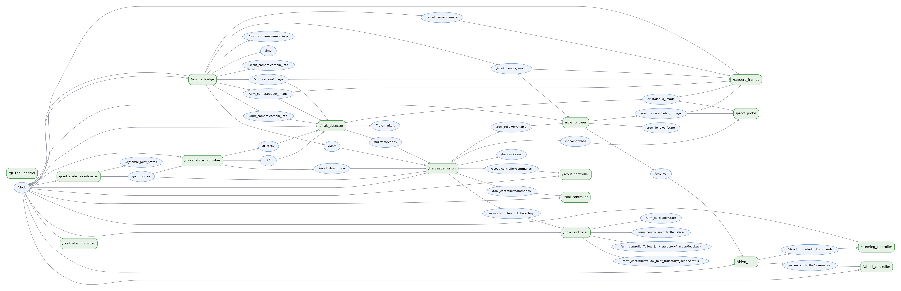

The graph above is drawn from the live ROS graph by `tools/sim/ros_graph.py`, during a pick in the clean run ([SVG](media/ros2/ros2_graph.svg)).

| Piece | What it does |
| --- | --- |
| `row_follower` | `/front_camera/image` → `/cmd_vel` while `/row_follower/enable` is true. Finds the bare-soil furrow between the black mulch beds and steers on two points of its centre line. Publishes `/row_follower/state` and a debug image |
| `fruit_detector` | `/arm_camera/image` + `/arm_camera/depth_image` + TF → `/fruit/detections` (fruit centres in `base_footprint`), RViz markers and a debug image |
| `harvest_mission` | The mission: survey pose, enable row-following, stop at fruit in reach, confirm, solve IK, cut, carry, drop, verify. Publishes `/harvest/phase` and `/harvest/count` |
| `drive_node` | `/cmd_vel` → steering angle (bicycle model, ±25°) and four wheel speeds, each set by the wheel's distance from the turn centre |
| `gz_ros2_control` + `controller_manager` | Runs the robot's joints in Gazebo through ros2_control |
| `wheel_controller` | Four wheel velocities |
| `steering_controller` | Left and right steering knuckles |
| `arm_controller` | JointTrajectoryController for J1, Z, J2, J3 |
| `tool_controller` | Blade and trap door |
| `scout_controller` | Scouting-camera pan |
| `joint_state_broadcaster` → `robot_state_publisher` | `/joint_states` → `/tf` |
| `ros_gz_bridge` | `/clock`, `/odom` (ground truth), `/imu`, all camera images and camera info |
| `capture_frames` | Saves the robot's camera and debug images on each `/capture` message |

**Row following:** each image row in the lower band is scanned for the soil run nearest the centre, and a line is fitted through the run midpoints. The near point (bottom of the image) mostly measures sideways offset and the far point mostly measures heading, so the yaw command is `-(1.4 · near + 1.6 · far)` at 0.15 m/s. A plain slope term had the wrong sign under perspective whenever the rover was off-centre.

**Fruit location:** for each red blob the 30th percentile of its depth pixels gives the near surface. The fruit centre is placed one fruit radius (28 mm) further along the camera ray, then transformed into the rover frame with TF.

**Stopping and confirming:** the mission stops when a detection inside the reachable window appears in two consecutive frames at the same world position (within 3 cm, through odometry). It then gathers 1.5 s of detections, clusters them within 3 cm, and keeps clusters seen in at least 30% of frames. It picks the nearest one.

**Arm targeting:** each pose is solved by damped least squares on the robot's own URDF (`agribot_gazebo/urdf_fk.py`), from several seeds, with the cutter's mouth turned to face the plant. The cut point is 30 mm above the estimated fruit centre, where the pedicel joins it.

## Running it

On the Ubuntu laptop, after the setup in [assets.md](assets.md):

```bash
cd ~/agribot_ws && colcon build --symlink-install && source install/setup.bash
```

```bash
ros2 launch agribot_gazebo demo.launch.py harvest:=true picks:=3
```

| Launch argument | Default | Meaning |
| --- | --- | --- |
| `gui` | `true` | Open the Gazebo GUI |
| `rviz` | `false` | Open RViz with the robot model and camera images |
| `harvest` | `false` | Run the harvest mission |
| `picks` | `2` | How many pick attempts; the mission also stops at the end of the row (4.6 m) |
| `mast_pin` | `3` | SCARA mast height, 0–4 |
| `capture_dir` | empty | Save camera frames and direct the GUI camera for filming |

To film, close or minimise other windows, then run:

```bash
tools/sim/ubuntu/film.sh ~/agribot_capture 3
```

It records the screen through GNOME's screencast service, cuts out the Gazebo 3D view, and writes the MP4, the GIF and one still per phase (`tools/sim/make_video.py`). It deletes the raw full-screen recording only once a good MP4 exists.

Before any run, `tools/sim/ubuntu/stop.sh` clears every node from earlier runs. A leftover detector or row-follower keeps publishing on the same topics and quietly changes the results.

The world is generated: `python3 tools/sim/make_world.py` writes `worlds/demo_row.sdf`, its fruit list (used only for the cut model and the diagnostic) and the bridge config.

## Modelling choices and limitations

These are deliberate simplifications. Each one is a known gap between this demo and the field.

- **Ripeness is not judged yet.** The detector is a colour rule: it finds red fruit, and half-ripe fruit have red undersides. Two of the three clean-run picks were half-ripe. A learned ripeness model is the next step; it will publish on the same `/fruit/detections`.
- **The colour rule suits this world.** Gazebo's lighting is even and the leaves are never red. Real fields have sun, shade and red-tinged stems, which is another reason for the learned model.
- **The pedicel is not detected.** The cut point is a fixed 30 mm above the estimated fruit centre. The estimates fell 6–24 mm from the true pedicel. The real cutter's throat is 6 mm wide, so on hardware only the best of these would cut cleanly; the fix is to find the pedicel itself in the image, or close in with the arm camera before the cut.
- **The cut model is generous.** When the blade closes, the node looks up the world-file fruit whose pedicel is within 3 cm of the throat and cuts that one. With no fruit that close, the cut misses. 3 cm is far wider than the 6 mm throat; it stands in for the V-capture guides funnelling the pedicel in, which the simulation does not model.
- **Fruit on the plants are static, and the robot passes through them.** They sit in collision group `0x04`, while the robot uses `0x01` and the cradle and crate use `0x03`. A real truss sways aside, but rigid welded fruit jammed the cradle in testing.
- **The cut is modelled.** When the blade closes, the node removes the fruit and spawns a free-falling copy at the same pose in group `0x02`, which the cradle and crate catch. Physics takes over from there: the fall into the cradle, the carry, and the drop into the crate.
- **Plant stems and stakes have no collision.** As rigid cylinders they stalled the arm, where a real stem bends.
- **Odometry is ground truth** (Gazebo's OdometryPublisher). Wheel encoders and the IMU would replace it on the robot.
- **The wheelbase, track and steering linkage are assumed** (see [work-plan.md](work-plan.md)) until the car is measured. Each front wheel turns on its own knuckle, both at the same angle (parallel steer, not Ackermann). Gazebo ignores the URDF `mimic` tag here, so the controller commands both knuckles.
- **The rover turns less sharply than the bicycle model says.** In an isolated test a 15.8° command gave about 4.5° of path curvature: the tyres slip. The row follower closes the loop on the camera, so this only slows its corrections.
- **The cutter is concept v0** ([scara-redesign.md](scara-redesign.md)), not a manufacturing design.

## Problems found and fixed on the way

| Symptom | Cause | Fix |
| --- | --- | --- |
| No controller manager | gz_ros2_control registers for newer Gazebo (`GZ_SIM_SYSTEM_PLUGIN_PATH`); Fortress reads `IGN_GAZEBO_SYSTEM_PLUGIN_PATH` | The launch file sets both |
| SCARA Z axis frozen | DART locks a prismatic joint that starts exactly on its limit | `initial_value` 0.05 m in ros2_control; the measured limits are unchanged |
| Z axis would not lift | Estimated damping (20 N·s/m) and speed limit (0.05 m/s) were unrealistic | 2 N·s/m and 0.1 m/s (8 mm lead at about 750 rpm) |
| Fruit launched across the field | A stale `wrist_link__motor.stl` from an earlier link split put the gripper servo inside the wrist's collision hull | `extract_links.py` clears its output first |
| Fruit rolled out while carried | The soft lip stood 0.5 mm above the foam | The lip now stands 16 mm above the foam (design change) |
| Fruit collision poked into the cutter | The collision sphere used the fruit's horizontal radius | It now uses the vertical semi-axis, which matches the real top and bottom |
| Leaves and fruit rendered black | Blender omits `Kd` for textured materials; Gazebo multiplies the texture by black | The exporter adds `Kd 1 1 1`; QA fails on any textured material without `Kd` |
| Arm camera saw only its own plate | It was mounted above the top plate, looking down | It now sits on the side, at fruit height, turned 28° in (design change) |
| Trap door would swing up into the fruit | Hinge axis sign | The axis is now (0, −1, 0), so positive angles swing the floor down |
| Dropped fruit fell through the crate | The crate had no collision | Floor and four walls added |
| Rover barely turned | One steering joint swung the whole front axle, scrubbing the tyres | A steering knuckle per front wheel |
| Right wheel stayed straight | Gazebo's ros2_control ignores `mimic` joints | Both knuckles are commanded |
| Wheels fought every turn | All four wheels were stiff velocity servos at the same speed | Each wheel's speed is set by its distance from the turn centre |
| Row follower steered the wrong way when off-centre | Under perspective a sideways offset also tilts the furrow line | Steer on a near and a far point of the line instead of its slope |
| Survey pose failed after a drop | IK started from the drop pose and fell into a poor local minimum | Solve from the current joints and several seeds; keep the best |
| Rover stopped for a fruit that was not there | Two frames 0.2 s apart were compared in the rover frame while it moved | Compare detections in the world frame through odometry, and drive at 0.15 m/s |
| Topic rates and detections doubled | Dozens of nodes from earlier runs were still alive | `stop.sh` matches every node; always run it first |
| The demo MP4 was replaced with an empty file | A failed processing run overwrote it | `make_video.py` writes to a temporary file and moves it into place only when it holds video |
